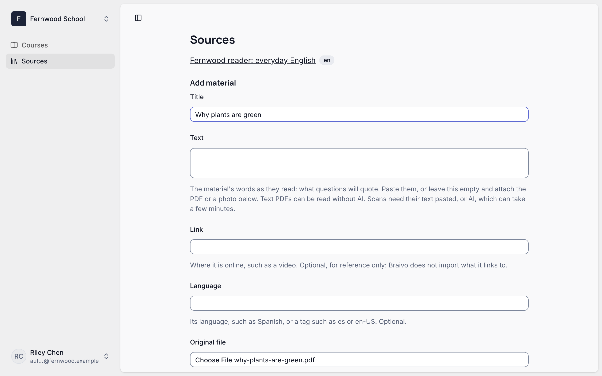
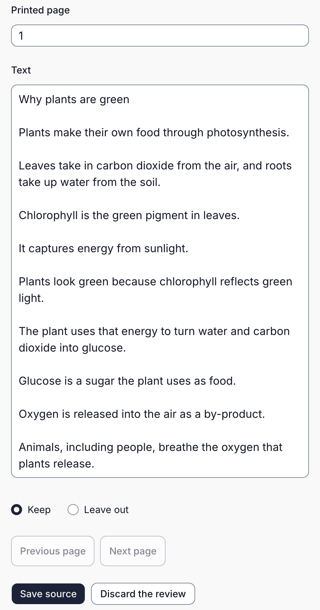
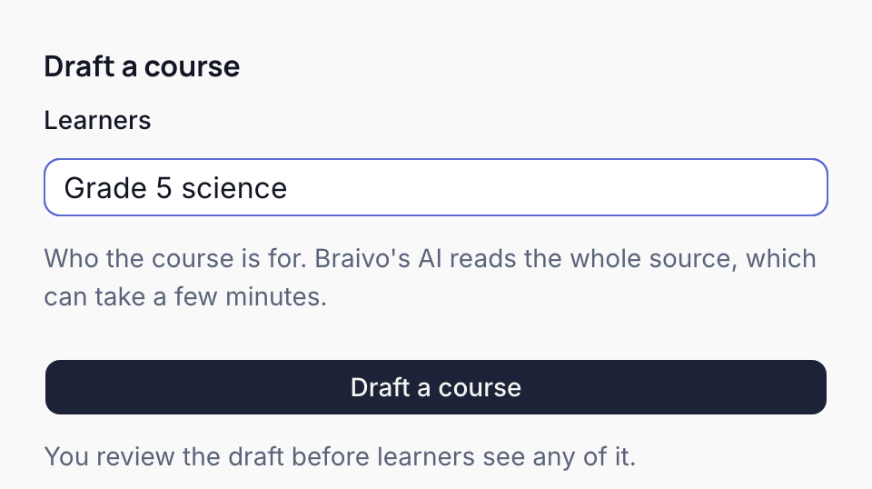
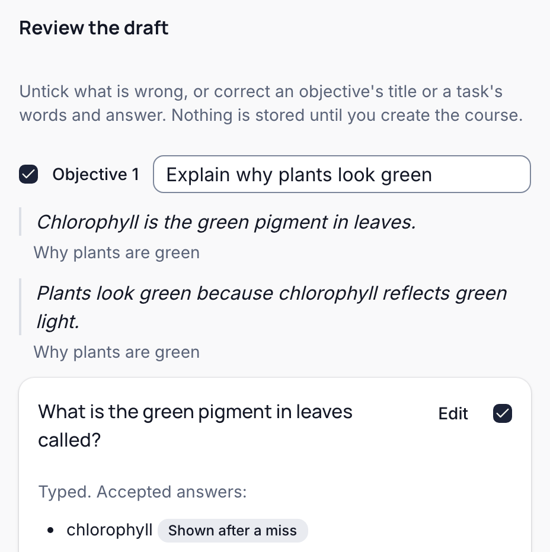
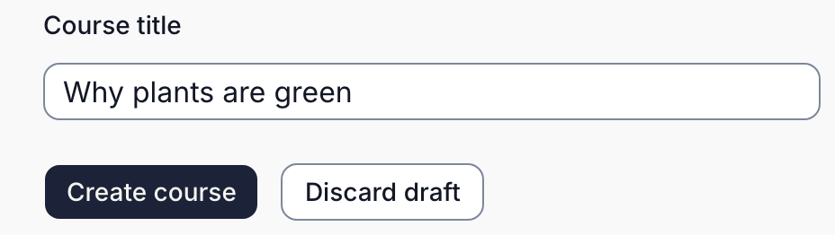
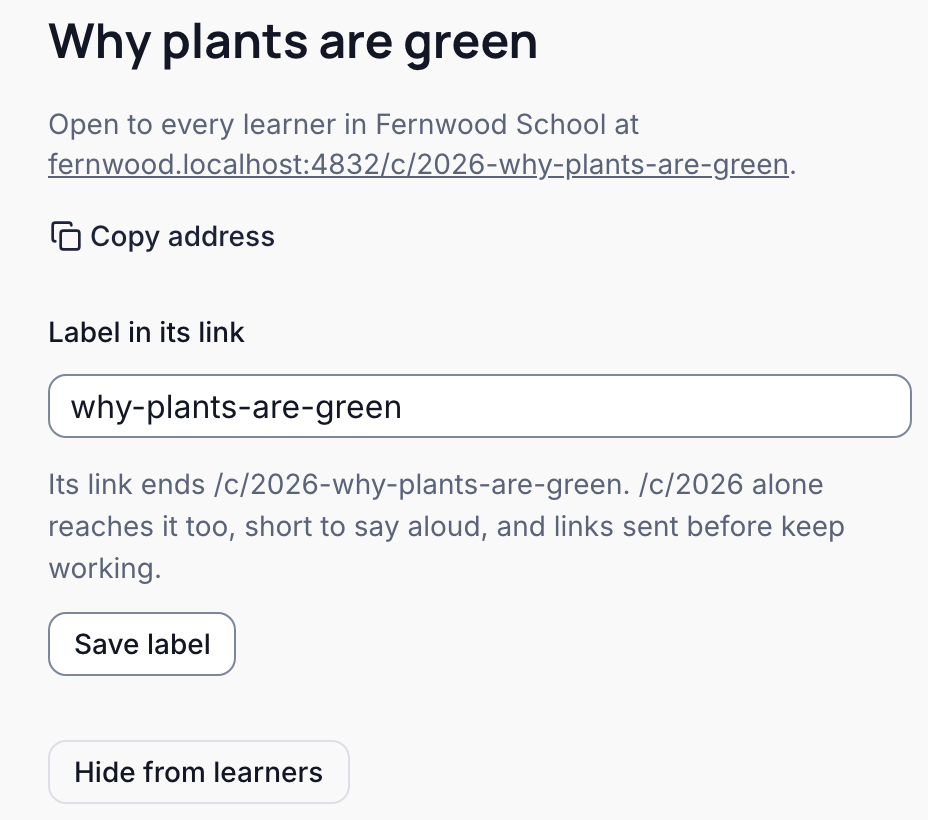
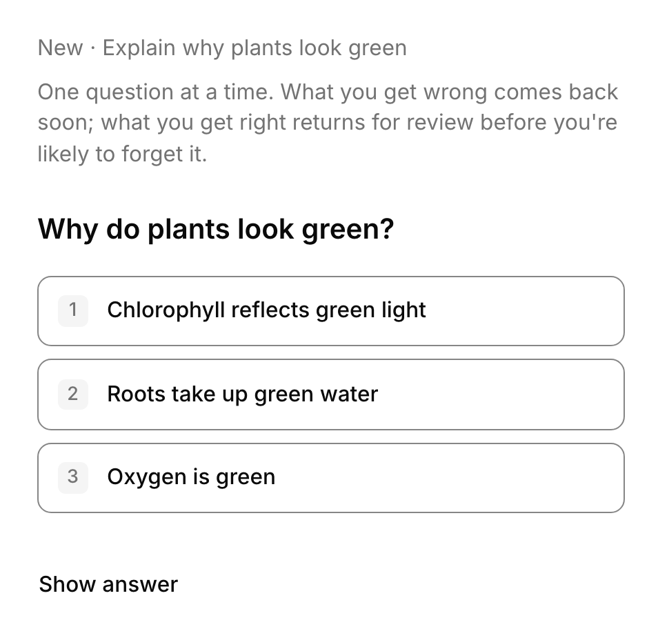

Turn a short PDF into practice your learners can use today. You need selectable text (other material: [choose and check it](./prepare-material.mdx)) and permission to prepare courses: Author, Owner, or Admin. Your learners must already have joined your school's learning site. The pictures show Fernwood School, a made-up school, with a one-page handout on why plants are green.

Sign in to your school's console: there, your school's space in Braivo is called an [organization](./words.mdx#organization), and a question a task. Open **Sources** from its menu; on a phone, open the menu first. If there is no **Sources**, ask your school's administrator to make you an Author.

<Steps>

<Step>

### Add your material

Under **Add material**, give it a **Title**, leave **Text** empty, choose your PDF as the **Original file**, and press **Add material**.

</Step>

<Step>

### Check its pages

The console reads the PDF's own text, without AI, and shows it a page at a time. Check every page against your PDF, pressing **Next page** to move on: correct misread **Text**, or choose **Leave out** for a page you don't want. Questions quote these words, so they need to be right. When every page is checked, press **Save source**. A one-page PDF, as here, has no next page.

> [!WARNING]
> If a scan has no selectable text, paste its text into **Text**, or choose to have Braivo's AI read it, which can take a few minutes.

</Step>

<Step>

### Draft a course

On the source's page, say who the course is for under **Learners**, and press **Draft a course**. Braivo's AI reads the whole source, which can take a few minutes.

> [!WARNING]
> If the console says **Braivo's AI is off for this organization**, ask whoever runs Braivo for you to turn it on, or draft with [your own AI app](./assistants.mdx).

</Step>

<Step>

### Review the draft

Under **Review the draft**, each [objective](./words.mdx#objective) says what a learner will be able to do, with the words it comes from quoted. Untick a question you don't want, or press **Edit**, correct it, and press **Save**. Nothing is stored until you create the course.

</Step>

<Step>

### Create the course

> [!WARNING]
> **Create course** publishes the questions you kept: learners can practise them at once. Finish checking them first.

Check the **Course title**, and press **Create course**.

If something went out by mistake, **Hide from learners** on the course's page takes the course back, and **Retire** beside a question removes it.

</Step>

<Step>

### Send learners there

The course's page says where learners reach it: your school's learning site. Press **Copy address**, and send it to your learners. Anyone who hasn't joined yet needs an invitation from your school's administrator.

If the page says it is open to every learner "once it has a site to practise on", your school has no learning site yet: ask your school's administrator, or whoever runs Braivo for you.

</Step>

<Step>

### See what they practise

Learners sign in and practise one question at a time: what they get wrong comes back soon, and what they get right returns for review before they are likely to forget it.

</Step>

</Steps>

Next: [follow your learners' progress](./follow-progress.mdx) once they practise, or [other ways to prepare material](./authoring.mdx), such as with your own AI app.
