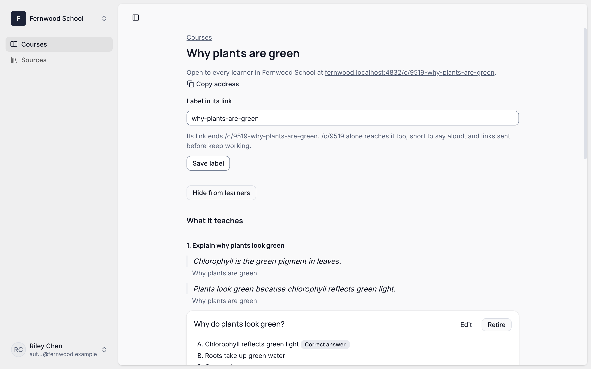
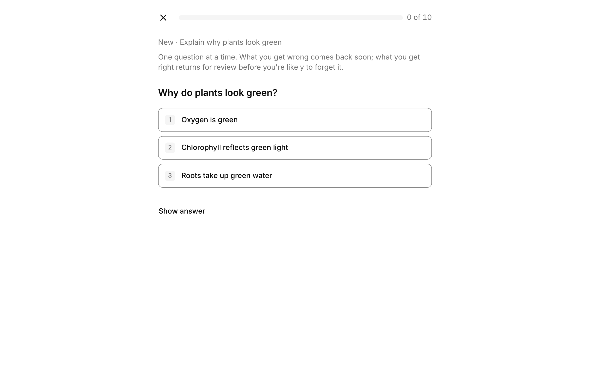

You need a PDF with real text, and to be an `owner`, `admin`, or `author` of your organization. The pictures show Fernwood School, a made-up school, with a one-page handout on why plants are green.

<Steps>

<Step>

### Add your material

Open **Sources**. Under **Add material**, give it a **Title**, leave **Text** empty, choose your PDF as the **Original file**, and press **Add material**.

</Step>

<Step>

### Check its pages

The console reads the PDF's own text, without AI, and shows it a page at a time. Correct a page's **Text**, or choose **Leave out** for one you don't want, then press **Save source**. Questions quote these words, so they need to be right.

<Callout type="warn">

A scanned PDF has no text to read. Paste its text into **Text**, or choose to have Braivo's AI read it, which can take a few minutes.

</Callout>

</Step>

<Step>

### Draft a course

On the source's page, say who the course is for under **Learners**, and press **Draft a course**. Braivo's AI reads the whole source, which can take a few minutes.

<Callout type="warn">

If the console says **Braivo's AI is off for this organization**, ask whoever runs Braivo for you to turn it on, or draft with [your own AI app](./assistants.mdx).

</Callout>

</Step>

<Step>

### Review the draft

Under **Review the draft**, each objective says what a learner will be able to do, with the words it comes from quoted. Untick what is wrong, and press **Edit** to correct a question or its answer. Nothing is stored until you create the course.

</Step>

<Step>

### Create the course

Check the **Course title**, and press **Create course**. Its page shows what it teaches, and where learners reach it.

<Callout type="warn">

**Create course** publishes it: learners can practise at once. To take it back, press **Hide from learners** on this page. To remove one wrong question, press **Retire** beside it.

</Callout>

</Step>

<Step>

### Send learners there

Press **Copy address**, and send it to your learners. They sign in, and practise one question at a time: what they get wrong comes back soon, and what they get right returns for review before they are likely to forget it.

</Step>

</Steps>

Next: [other ways to prepare material](./authoring.mdx), such as with your own AI app.
