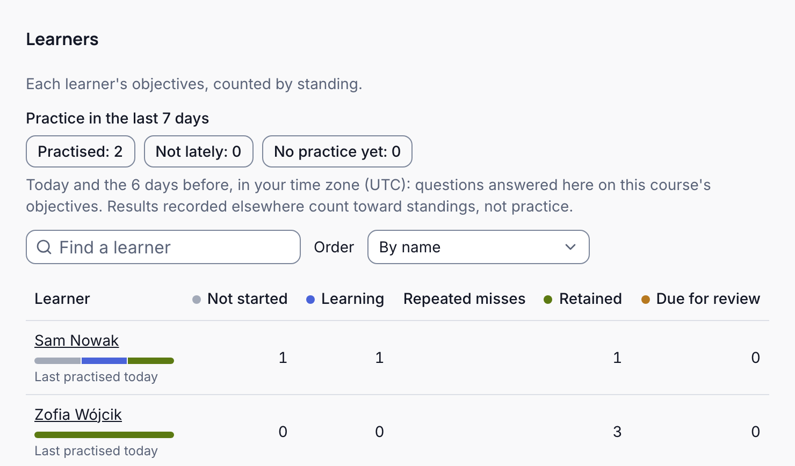
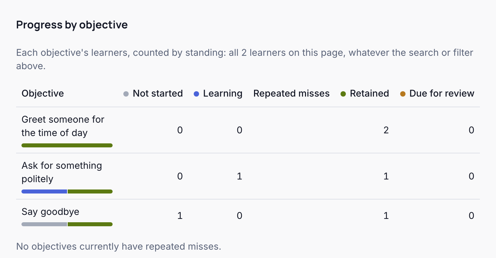

Braivo tracks each learner on each objective of a course, from their answers. Who sees it depends on what you do at the school, not on who wrote the course:

| You are            | You see                                                                    |
| ------------------ | -------------------------------------------------------------------------- |
| An Owner or Admin  | every member's progress, in every course                                   |
| A group's teacher  | the learners of the groups you teach, in the courses those groups take     |
| An Author, as such | none: preparing courses grants no one's progress, unless you teach a group |

Learners see their own, on each course's card and where practice pauses. The pictures show Fernwood School's Class A English, taught by Jordan Price.

## The four standings

1. **Not started:** no answers yet. Nothing to do: Braivo introduces it when the learner is ready for new material.
2. **Learning:** practice has begun, and the learner hasn't answered it right since. Braivo asks again soon. Watch for repeated misses.
3. **Retained:** answered right, and Braivo estimates how likely the learner is to remember it. Nothing to do.
4. **Due for review:** that estimate has fallen, and Braivo brings it back next. Nothing to do, unless it keeps coming back to Learning.

A miss on a retained or due objective sends it back to Learning, and a right answer moves it on.

## Read your group

Open **Groups**, and press **Progress** beside the course.

**Learners** counts each learner's objectives by standing. **Order** sorts them, by most repeated misses, say, and a name opens that learner's report.

**Progress by objective** counts the same the other way round, so you can see what your group finds hard.

A learner's report shows each objective's standing, its estimated recall, and when its review falls due.

## Repeated misses

An objective still being learned, missed 3 or more times since its last correct answer, shows under **Repeated misses**. Show answer counts as a miss. It is a signal to check on the learner, not a diagnosis: they may need the material explained another way, or a question may be unclear.

## What a standing is, and isn't

<Callout>

A standing is an estimate from answers, not a grade or a test score. Just after a right answer, estimated recall can read 100%, which says nothing yet about long-term memory.

</Callout>

- Estimates count learning in your school's other courses that teach the same objectives.
- A page is worked out when you open it: **Refresh** brings it up to date.
- If you teach the course to several groups, its page counts their learners together.
