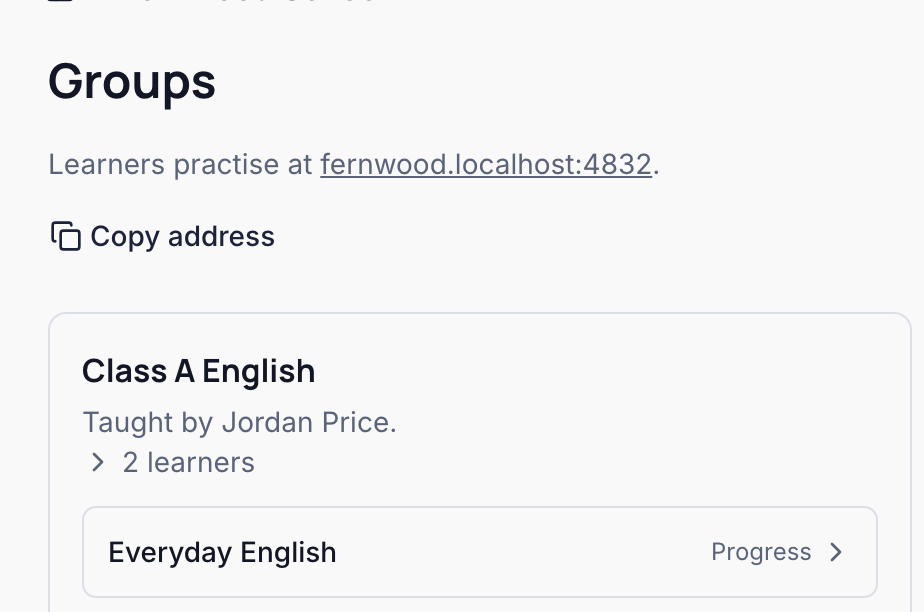
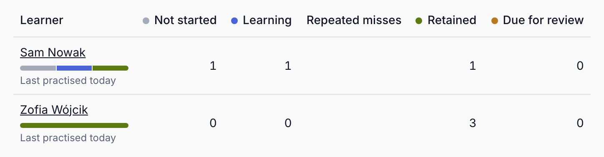
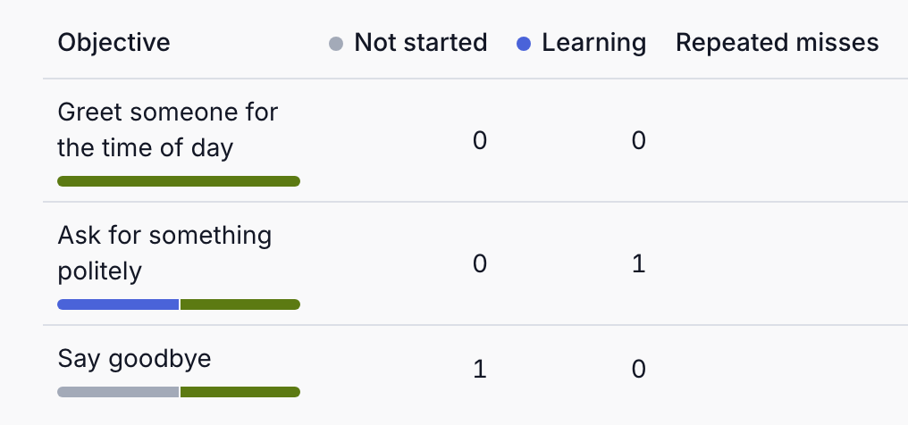
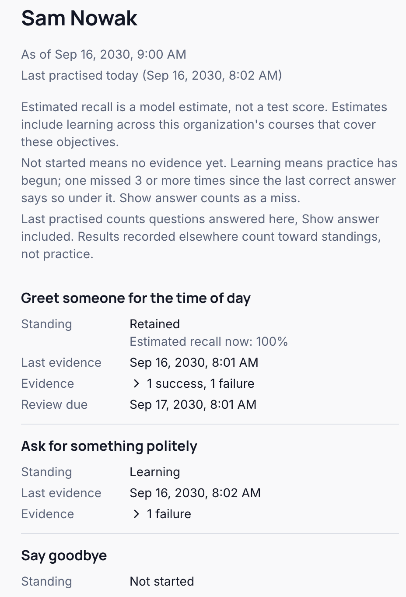
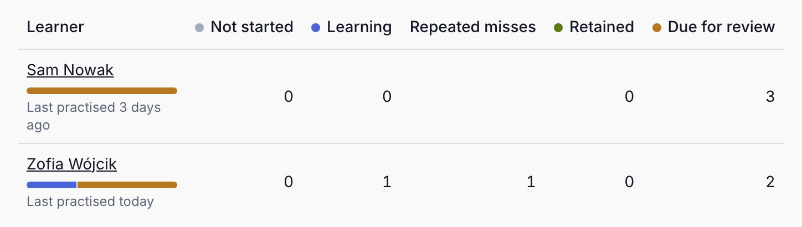
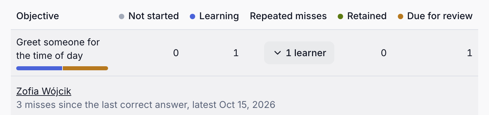

See which learners may be struggling, and who to check on. Braivo tracks each learner on each [objective](./words.mdx#objective) of a course: one learning target, such as asking politely, which several questions can practise. The counts below are objectives, not questions or marks. Who sees them depends on your role, not on who wrote the course:

| You are                        | You see                                                                |
| ------------------------------ | ---------------------------------------------------------------------- |
| An Owner or Admin              | every member's progress, in every course                               |
| A group's teacher              | the learners of the groups you teach, in the courses those groups take |
| An Author who teaches no group | none: preparing courses grants no one's progress                       |

Learners see their own, on each course's card and where practice pauses. The pictures show Fernwood School's Class A English, taught by Jordan Price.

## The four standings

<Callout>

A standing is an estimate from answers, not a grade or a test score. A right answer, even one, makes an objective Retained, and estimated recall can read 100% just after it: that says nothing yet about long-term memory.

</Callout>

1. **Not started:** no recorded results yet.
2. **Learning:** the latest result was a miss, at first practice or after an earlier success. Braivo offers more practice.
3. **Retained:** the latest result was right, and Braivo estimates how likely the learner is to remember it. No extra review is scheduled yet.
4. **Due for review:** estimated recall has fallen below Braivo's review target, so it is due again; material still being learned can come first. It isn't a missed deadline.

These are where each objective stands now, not steps in order: a right answer makes Not started or Learning Retained, time can make it due, and a miss makes it Learning again.

## Read your group

Open **Groups**, and press **Progress** beside the course.

**Learners** counts each learner's objectives by standing; **Order** sorts them, and a name opens that learner's report.

**Progress by objective** counts the same the other way round, so you can see what your group finds hard.

A learner's report shows each objective's standing, its estimated recall, and when its review falls due.

## Repeated misses

An objective still being learned, missed 3 or more times since its last correct answer, has repeated misses; Show answer counts as a miss. Three days on in the demo, Zofia has missed the greeting three times, and reviews have come due:

Under **Progress by objective**, open the count to see who, and choose a name to see their report.

It is a signal to check on the learner, not a diagnosis: they may need the material explained another way. If a question seems unclear, ask an Author or Admin to look at it: a group's teacher can't edit questions.

## What else to know

- Estimates count learning in your school's other courses that teach the same objectives.
- A page is worked out when you open it: **Refresh** on the course's progress brings it up to date.
- If you teach the course to several groups, its page counts their learners together.
