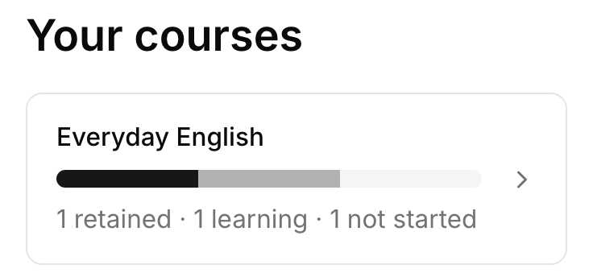
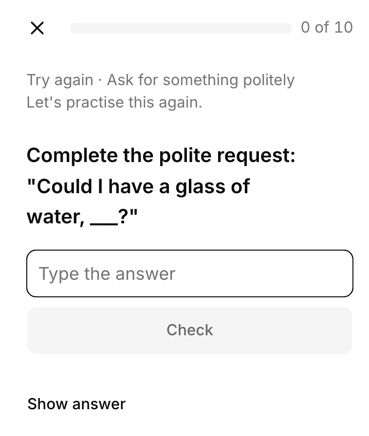
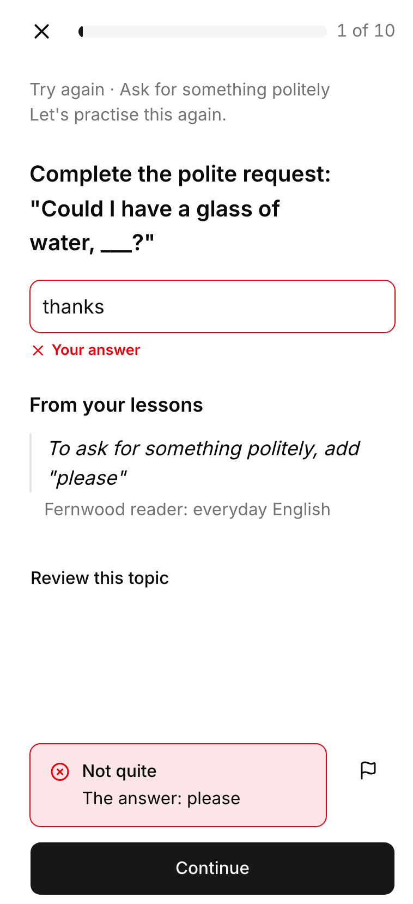
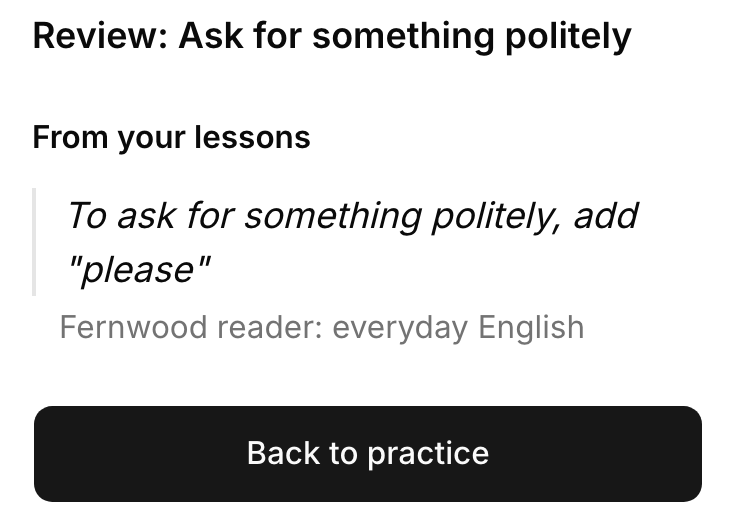
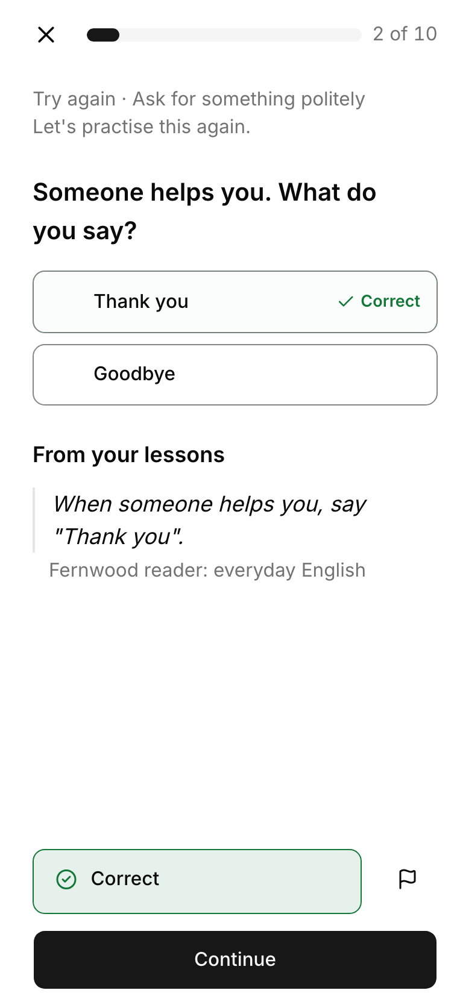
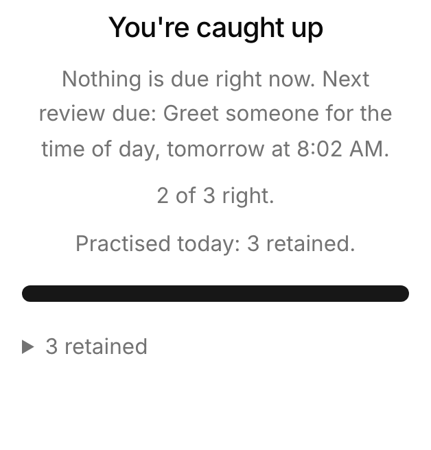

Learners practise on your school's learning site, mostly on their phones. The pictures follow Sam, a learner at Fernwood School, a made-up school, through a short course on everyday English: Sam missed asking politely once before.

<Steps>

<Step>

### Their courses

Each course shows where the learner stands: how many of its objectives, the things it teaches, they retain, are still learning, or haven't started.

</Step>

<Step>

### A question, chosen for them

Braivo chooses what comes next: here, what Sam missed comes back first, as a different question, and says why. A new objective's question is marked **New**, and a review says how likely the learner is to recall it now.

</Step>

<Step>

### A miss

Braivo grades the answer at once, without AI: **Not quite**, the right answer, and the passage of your material the question quotes, under **From your lessons**. A question with an explanation shows it here too.

</Step>

<Step>

### Review this topic

After a miss, **Review this topic** shows what your material says about the whole objective, before the next try.

</Step>

<Step>

### A right answer

A question just answered rests for a while, so its next try shows what the learner remembers rather than what they just read. Meanwhile Braivo can ask another question on the same objective; a right answer makes it retained.

</Step>

<Step>

### Practice pauses

When nothing is due, the learner is caught up, and told when the next review falls due: before Braivo estimates they would forget it.

</Step>

</Steps>

## What else they may see

- **Take a short break**, when everything they could practise is resting, with the time practice continues.
- **That's all the new material for today**, after twenty new objectives in a day; reviews and what they are still learning carry on.
- Practice comes in sessions of ten answers.
- **Show answer** shows the answer, and counts as a miss.

What learners see of their standing, you see for your groups: [follow their progress](./follow-progress.mdx).
