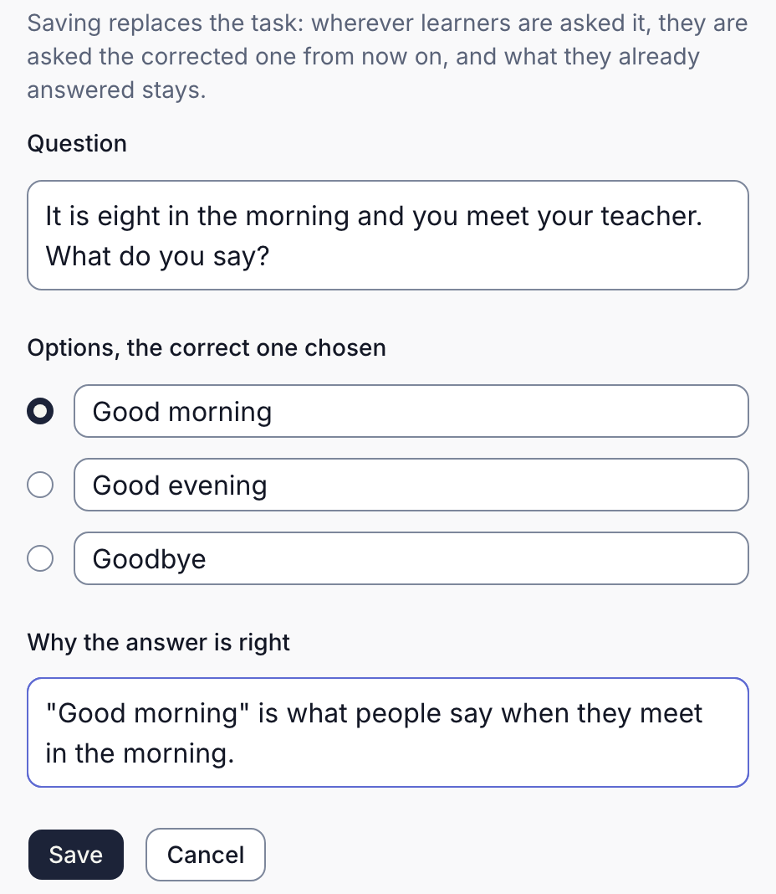
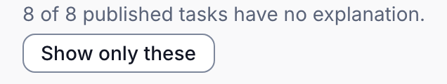
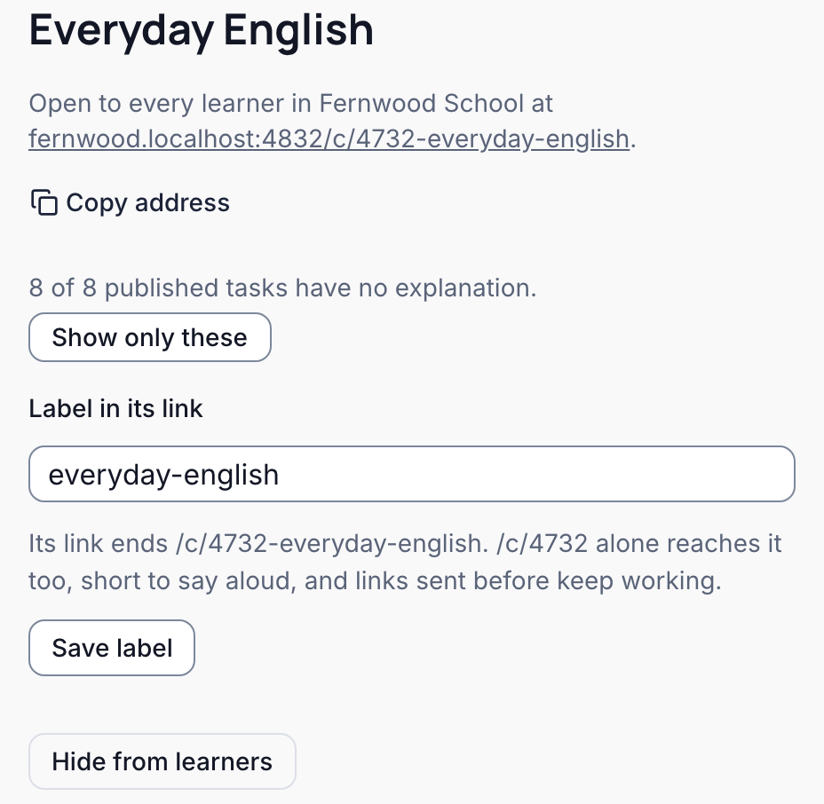

Once a course is published, you keep it right from its page in the console: **Courses**, then the course. You need to be an Owner, Admin, or Author. The console calls a question a task. The pictures show Fernwood School's Everyday English.

## A question is wrong

1. Find the question on the course's page, and press **Edit**.
2. Correct the **Question**, its options and the correct one, or its accepted answers, and **Why the answer is right**.
3. Press **Save**. A published question's correction reaches learners at once, wherever they are asked it; what they already answered stays.
4. If it can't be fixed, press **Retire**: Braivo asks first, then stops asking it.

A correction your AI app sends waits instead, shown above the question as published now, until you [publish it](./review-and-publish.mdx).

## Add the missing explanations

An explanation is what a learner reads after answering.

1. Under the course's title, a line counts the published questions with no explanation, and those waiting for review; each is marked **No explanation**.
2. Press **Show only these** to list the gaps, and any corrections waiting to fill them; **Show all** brings back the rest.
3. If your AI app's correction already supplies the explanation, review and [publish it](./review-and-publish.mdx).
4. Otherwise, press **Edit**, write **Why the answer is right** from the passage it quotes, and press **Save**.

Or ask your AI app: "add an explanation to each question in this course that has none, from the passage it cites". Its corrections wait for your review.

## The source itself was wrong

A source can't be changed, and nothing removes a passage once quoted. Questions that quote a wrong source are corrected with new text:

1. Add the corrected text as a new source
2. Your AI app writes each affected question again, quoting the new source, as a correction of the old one
3. You publish the corrections in the console
4. Each replaces the question it corrects, which is retired; learners' past answers stay

This corrects the questions, not the objective's own passages: learners still see the old ones in **Review this topic**. If a wrong passage must go, hide the courses that include its objective, and prepare replacement objectives and a course from the corrected source. Replacement objectives start new estimates of what each learner knows.

Check the new source's words first, as [checking the words](./prepare-material.mdx#check-the-words-before-you-build-on-them) shows.

## Take a course down

1. Press **Hide from learners** on the course's page. Braivo asks first; what learners learned stays.
2. The course is marked **Hidden**. **Show to learners** brings it back.

A course not yet published has **Delete course** instead; its objectives and questions stay.

## A question appears in more than one course

Courses arrange objectives, and an objective's questions belong to it, not to a course:

1. Two published courses include the same objective
2. Its questions are one set, published once
3. Publishing or correcting one reaches every course that includes the objective

- Braivo asks first when what you publish reaches other published courses.
- An objective in no course, or in several while questions wait, is listed under **Other objectives** on **Courses**, and published from the objective's page. Learners are asked its questions only once a published course includes it.
- A question you retired that your AI app sends again waits like any other, marked "An identical task was retired before."
