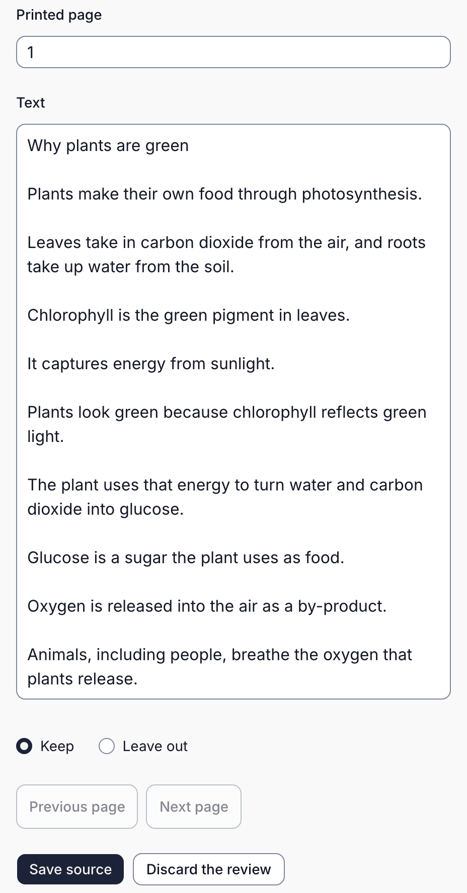

Braivo keeps your material's words as a source. Its own draft quotes that text; when you review questions from elsewhere, check the passages they quote too. What you have decides how to start.

| What you have                                          | What to do                                                                                                                                                    | What to check                                             |
| ------------------------------------------------------ | ------------------------------------------------------------------------------------------------------------------------------------------------------------- | --------------------------------------------------------- |
| Teaching material: a textbook chapter, notes, a lesson | Add it, then draft a course in the console, as in [your first course](./first-course.mdx), or ask [your AI app](./draft-with-ai-app.mdx) for practice from it | Its words, then every question and its answer             |
| An existing question bank or past exams                | Keep it as it is by converting it: a technical job for now, [described in authoring](./authoring.mdx#convert-an-existing-question-bank)                       | Every answer key; leave out questions that need a picture |
| A scan or a photo of a page                            | Paste its text, or let Braivo's AI read it, then [check its words](#check-the-words-before-you-build-on-them)                                                 | Every word, columns and tables especially                 |
| A video's captions                                     | Under **Sources**, **Add material**: paste the transcript into **Text**, and the video's address into **Link**                                                | Names and terms the captions misheard                     |
| A video's address alone                                | Braivo doesn't fetch it: get its captions where it's published, or [import them with their timings](./authoring.mdx#the-braivo-command), a technical job      | That captions exist, and read right                       |
| Material you already added, used for another purpose   | Use its source from **Sources**, and [ask your AI app](./draft-with-ai-app.mdx#what-to-ask-for) for the new purpose                                           | That the new questions practise the new purpose           |

For another purpose, ask your AI app, for instance: "From the existing source _Driving theory questions_, prepare vocabulary practice for the words needed to understand its statements. Quote a statement for each word." Braivo's own draft can't be told a purpose. New questions come with new objectives, so progress on the old ones doesn't carry over.

## Drafting writes new questions

Braivo's own **Draft a course** reads the whole source, with [what its form asks](./first-course.mdx#draft-a-course), and writes new questions: a bank drafted comes back partly rewritten, not kept. To draft from one chapter, add it as its own source; your AI app can work from a range of pages.

## Check the words before you build on them

Questions can quote the saved text, so check it against your original before drafting: a misread word reaches every question that quotes it. A source can't be changed once added: a mistake found later means [a new source and corrected questions](./maintain-practice.mdx#the-source-itself-was-wrong), and the old source's passages stay.

- **A PDF:** the console reads its own text, without AI, a page at a time. Compare each page with your PDF, correct its **Text**, or choose **Leave out**, then **Save source**. If it reads badly, **Read the whole file with AI instead**, and check that the same way.
- **A photo, or a scan read by AI from the start:** it's saved as a source at once. Open it, and compare its **Source text** (**Show all text**) with the photo before drafting; if it's wrong, add a corrected text as a new source. Or paste a checked transcription into **Text** to begin with.

## What doesn't carry over yet

- A source is text: a question that depends on a picture can't be practised. Leave it out, and keep a list.
- Braivo's AI reads a PDF of up to 24 MB, or a PNG, JPEG, GIF, or WebP image of up to 7.5 MB, when whoever runs Braivo for you has turned it on.

Any AI that reads your material sends it to its provider: share only what your school allows ([where it goes](./faq.mdx#does-our-material-go-to-an-ai)).
