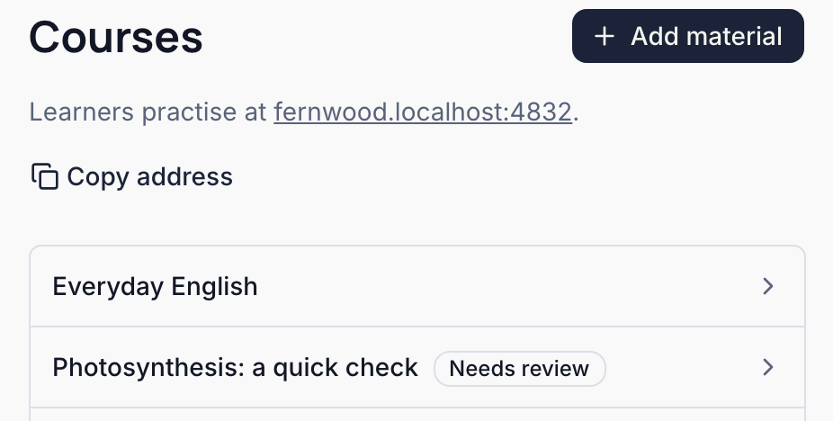
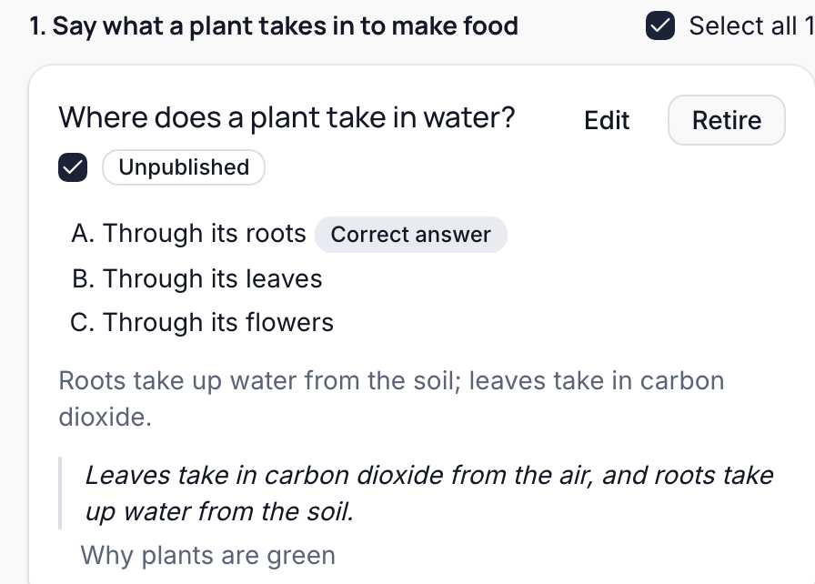
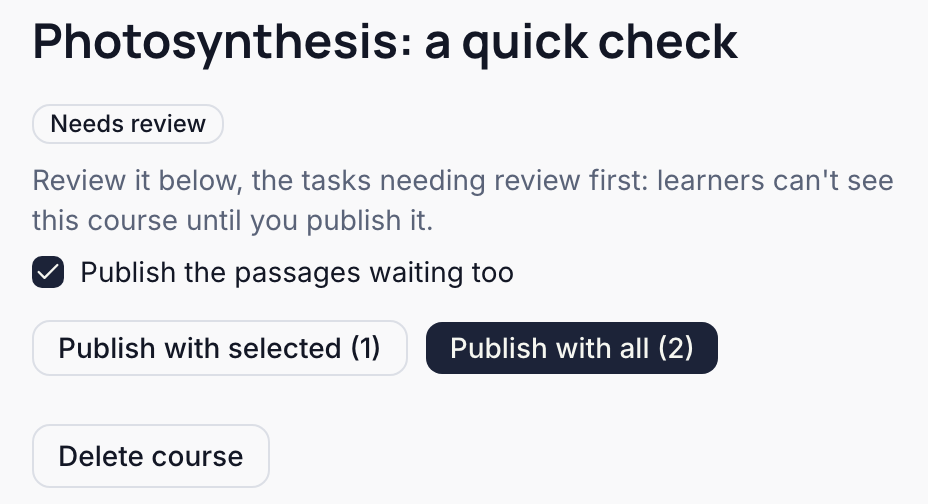
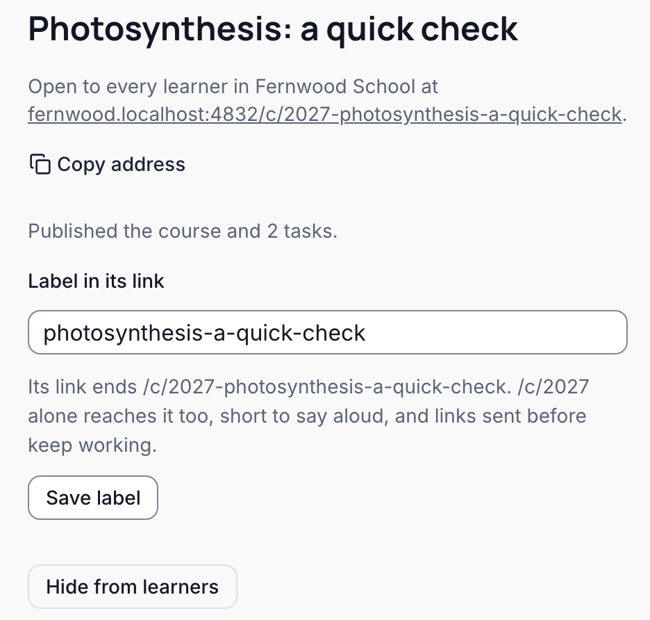

A course or question your AI app or a script prepares reaches no learner until you publish it in the console. You need to be an Owner, Admin, or Author. The pictures show a course a tool wrote for Fernwood School.

| What                                                       | Learners get it                                         |
| ---------------------------------------------------------- | ------------------------------------------------------- |
| A course, question, or quoted passage from your AI app     | once you publish it                                     |
| Your AI app's correction of a published question           | once you publish it; until then, the question as it was |
| A course you create in the console from Braivo's own draft | at once                                                 |
| A question you correct in the console                      | as you save it                                          |

<Steps>

<Step>

### Find the course

Your AI app may give you a link to it. Otherwise open **Courses**: a course waiting for you is marked **Needs review**.

</Step>

<Step>

### Check each question

On the course's page, the questions waiting come first, under **Needs review**, each marked **Unpublished**: its answer marked **Correct answer**, its explanation, and the passage it quotes from your material. Braivo checked that the passage is in your material, not that the answer is right: that is yours to check. **Edit** corrects a question, and **Retire** removes it. Tick each question you have checked.

</Step>

<Step>

### Publish all, or a selection

Press **Publish with all** to publish the course with every question. Or press **Publish with selected** to publish the course with just the questions you ticked: the rest keep waiting. Leave **Publish the passages waiting too** ticked, so the passages your AI app quoted are published with them.

<Callout type="warn">

If what you publish would leave an objective with no questions, Braivo asks first: learners skip that objective until it has one.

</Callout>

</Step>

<Step>

### Send learners there

The course is now open to every learner in your school at its address: press **Copy address** to send it. Learners get only what you published.

</Step>

</Steps>

## After publishing

- Questions your AI app adds to a published course wait too: **Courses** says how many need review, and the course's page lists them first. Publish them as above.
- A correction your AI app sends is shown above the question as published now, and replaces it once you publish it.
- **Hide from learners** takes a published course back, and **Show to learners** brings it back; what learners learned stays.
- Before publishing, **Delete course** removes a course you don't want; its objectives and questions stay, for other courses.
- Questions of an objective in no course, or in several, are listed under **Other objectives**, below the courses, and published from the objective's page.
- A question you retired that your AI app sends again waits like any other, marked as identical to one retired before.
