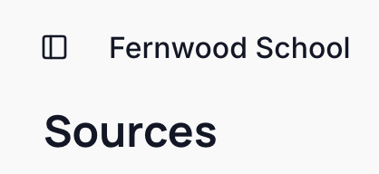
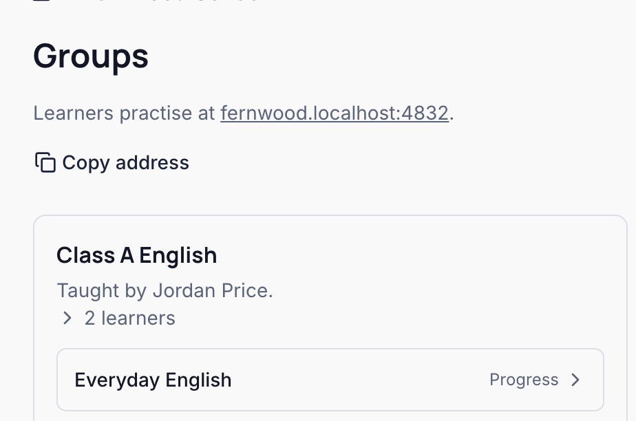
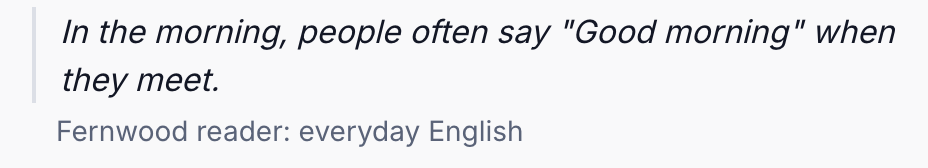
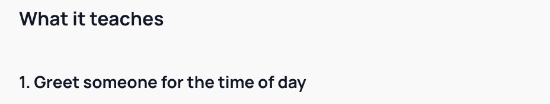
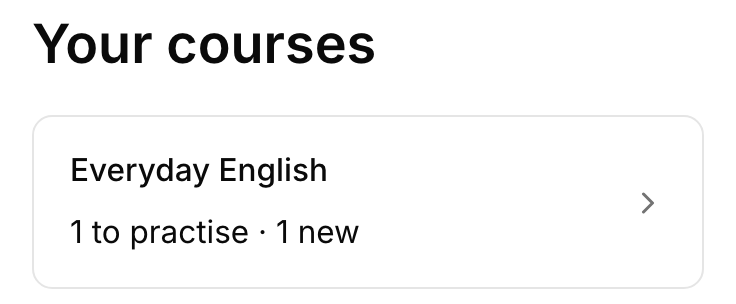
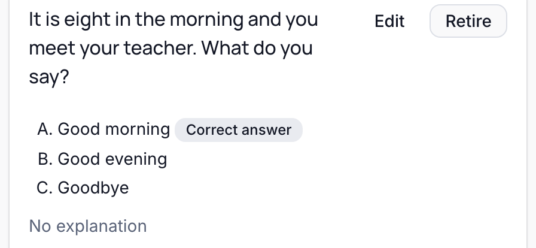
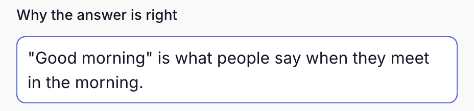
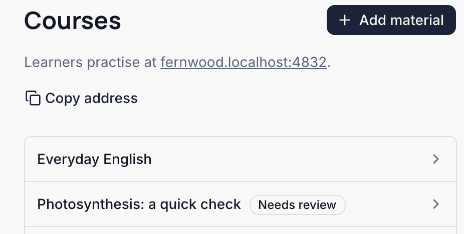

The words the guides and the console use, each with where it shows in Braivo. The pictures show Fernwood School, a made-up school.

## Organization

Your school's space in Braivo: it holds your courses and their material, and its people, each with a role. More: [your first course](./first-course.mdx).

## Group

A class, or any learners taught together, with its teachers. Its teachers follow its learners' progress. More: [follow your learners' progress](./follow-progress.mdx).

## Material and source

Material is what you bring: a PDF, notes, a transcript. A source is its text as saved in Braivo, which doesn't change once added; questions quote the source. More: [choose and check your material](./prepare-material.mdx).

## Passage

A stretch of a source's words that a question or an objective quotes. A learner sees it after answering, and in a review of its objective. More: [what your learners see](./learner-view.mdx).

## Objective

One learning target, such as greeting someone for the time of day. Braivo estimates what each learner knows of each objective, and several questions can practise one. More: [follow your learners' progress](./follow-progress.mdx).

## Course

An ordered set of objectives that learners practise. One objective can be in several courses, sharing what each learner learned of it. More: [correct and manage published practice](./maintain-practice.mdx#a-question-appears-in-more-than-one-course).

## Question

One thing a learner answers, by choosing an option or typing the answer, practising one objective. The console calls it a task. More: [correct and manage published practice](./maintain-practice.mdx).

## Explanation

A question's own account of its answer, which a learner reads after answering, never before. More: [add the missing explanations](./maintain-practice.mdx#add-the-missing-explanations).

## Needs review

What an AI app or a script prepares waits, marked **Needs review**, until someone publishes it in the console. Published, it reaches learners. More: [review and publish](./review-and-publish.mdx).

## Standing

Where a learner stands on an objective now: an estimate from their answers, not a grade. More: [the four standings](./follow-progress.mdx#the-four-standings).

1. **Not started:** no recorded results yet.
2. **Learning:** the latest answer was a miss.
3. **Retained:** the latest answer was right.
4. **Due for review:** estimated recall has fallen below Braivo's review target.

