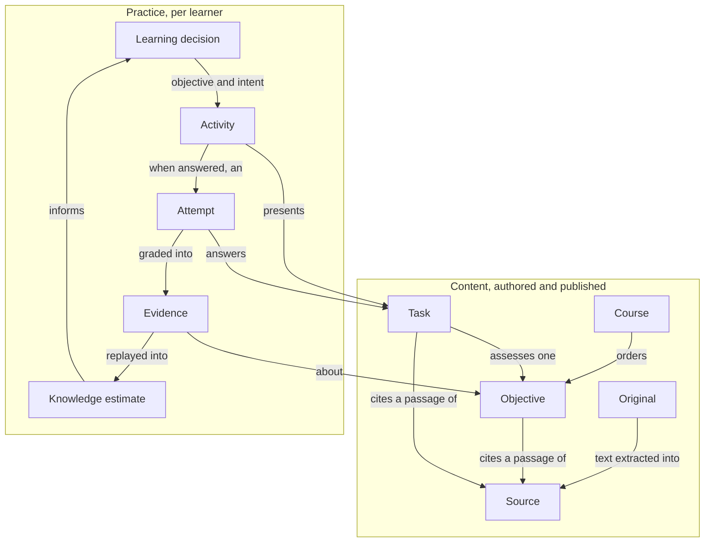

# Glossary

Canonical terms for Braivo's docs, code, API, MCP tools, CLI, and the console. Use each term as written here, in code and prose alike; where the code spells it differently, the code name follows in parentheses. Learners' copy, in any language, may say what reads naturally to a learner instead (a task is a question, an intent to review is Review), but never a word this glossary gives another term. A "Not" note names a synonym to avoid and why. User roles are defined in `product.md`; how they appear in code is below.

## Product and platform

- **Braivo:** the self-hostable product: run it yourself, or consume it as the managed Braivo Cloud service.
- **`braivo`:** this public repository, holding the self-hostable Braivo platform. Use this name in dependency and code-ownership rules.
- **Braivo Cloud:** the managed Braivo service — Braivo plus closed-source code of its own for tenancy, billing, provisioning, and custom-domain setup. An engineering term, not a separate customer-facing product.
- **Core:** the `content`, `learning`, and `ai` modules in `braivo`.
- **Public contract:** an explicitly documented endpoint, type, or entry point intended for external use. Undocumented internals are not supported integration points.
- **Tenant:** an isolation boundary within Braivo Cloud for a customer's data and operations. Tenant isolation is Braivo Cloud's responsibility. Not a synonym for organization: whether an organization is the tenancy boundary is undecided ([ADR 0006](adr/0006-better-auth.md)).
- **Learn app** (`apps/learn`): the learner-facing app. White-label: on an organization's domain, such as `fernwood.example`, it wears that organization's brand and serves its courses alone. `demo.braivo.app` is Braivo's own deployment of it ([ADR 0004](adr/0004-one-application-origin.md)).
- **Console** (`apps/console`): the application content owners use to manage their organization. It owns the root of the installation's origin, never an organization's domain, and addresses organizations by slug: `braivo.app/<organization>` on Braivo Cloud ([ADR 0004](adr/0004-one-application-origin.md)).
- **Braivo Design System:** the whole of Braivo's visual language — tokens, components, their stories, and the conventions for using them. `@braivo/ui` is its React implementation and `apps/storybook` its catalog ([ADR 0011](adr/0011-ui-and-auth-client-packages.md)).

## People and access

- **Organization** (`organization`, `organizationId`): the group that owns the learning content and organizes the people using it. The API addresses one by its ID; the console by its slug, as `/<organization>/…` ([ADR 0004](adr/0004-one-application-origin.md)). Not "workspace", which means the Vite+ workspace here.
- **Member** (`member`): a person's membership in an organization, managed by Better Auth ([ADR 0006](adr/0006-better-auth.md)). A member record carries one or more **organization roles** — `owner`, `admin`, `author`, or `member` — in its `role` field, comma-separated; `readOrganizationRoles` splits them, so nothing compares the whole string. Membership is what authorizes access to an organization's courses — it is enrollment, for now — and learners are to gain it through Braivo's invitation flow, which is not built yet (Better Auth's own are refused meanwhile; see [access](specs/access.md)); course-specific enrollment waits for a customer who needs it ([ADR 0018](adr/0018-sign-in-and-invitations.md)). A request naming an organization authorizes nothing.
- **Content owner:** the person or organization that owns and manages the learning content — an educator, school, training provider, or learning product ([product.md](product.md)). The organization roles `owner`, `admin`, and `author` manage its content, an `author` on the organization's behalf, not owning it ([ADR 0048](adr/0048-author-role.md)); grading and reading every learner's progress stay `owner` and `admin`'s. A learner preparing their own practice is the owner of an organization of their own. Not "teacher", since content owners include schools and products and a teacher is a role in a group, and not "admin", which names one of those roles rather than all three.
- **Learner** (a Better Auth `user`; `learnerId` is that user's ID): a person whose learning state Braivo tracks and for whom it selects what to learn next. Learners reach an organization's courses through membership in it, which they are to gain by accepting an **invitation** through Braivo's invitation flow ([ADR 0018](adr/0018-sign-in-and-invitations.md)); how they get it today is in [access](specs/access.md). One account may learn at several organizations, each recording evidence in the learner's one history and reading only its own ([ADR 0032](adr/0032-learner-history.md)). Not "student", and not "user" in domain code: `user` is the account every learner has.
- **Group** (`group`, `groupId`): an organization's learners and teachers taking some of its courses together — a school's class, a tutor and one student, a cohort. Each person is in it in one **group role**, `learner` or `teacher`. A **teacher** of a group reads its learners' progress in its courses, and nothing else; teaching is not an organization role ([ADR 0042](adr/0042-groups-scope-teaching.md)). Not "class", which only schools have, or "team".
- **Learner session** (`learner_session`; the `__Host-braivo-learner` cookie): Braivo's own session on an organization's domain, for one user in that organization, opened there by a code sent for that domain, or, after Google, handed over from the installation's origin. It grants nothing: membership is checked on every request. Not the account's session, Better Auth's, which never leaves the installation's origin ([ADR 0018](adr/0018-sign-in-and-invitations.md)).
- **Handoff** (`learner_handoff`; `/api/session/sign-in`, `/api/handoffs/:id`, `/api/session/handoff`): one sign-in with Google for an organization's domain, whose codes sign in on the domain itself — started there, completed by a member signed in on the installation's origin, redeemed back on the domain as a learner session. Not "SSO" or "redirect", which name the mechanism, not this flow ([access](specs/access.md)).

## The learning model at a glance

How the terms below relate. Content is authored from material; a learning decision picks an objective and why; the application presents an activity; an answer becomes evidence; estimates are derived from evidence under a model version, their predictions also depending on the time since, and inform the next decision.

A course orders objectives and owns none; a task assesses one objective; an activity is assembled, never authored; no recorded input but evidence changes an estimate.

## Material

Where content comes from. Braivo teaches from what a content owner brings, never from nothing ("Content first", [product.md](product.md)), so the file, its text, a range of that text, and the claim that something was written from it are four terms, not one.

- **Original** (`original`; a file's `fileId`, the SHA-256 of its bytes): the uploaded file a source's text was extracted from, kept in the installation's file store ([ADR 0028](adr/0028-original-files.md)). Not the source: citations quote the text, never the file.
- **Source** (`source`, `sourceId`; **source content** in full): material a content owner provides, stored as immutable text — a transcript for audio or video — that whatever is derived from it is grounded in. It may hold all of a file or part of one, one file may back several, and one may serve several courses. Authoritative for what is taught. Extracting the text from a file happens before the source is added, by Braivo's model ([ADR 0030](adr/0030-server-extraction.md)) or by the content owner's own tools; a revision is a new source ([ADR 0020](adr/0020-source-content.md)). Not "document" or "material", which name the file rather than its text.
- **Timing** and **pagination** (`timing`, `pagination`): where each part of a source's text begins in the recording or the book it came from — a second, or a page labelled as printed — so a passage cited from it names its moment or its page ([ADR 0025](adr/0025-timed-transcripts.md), [ADR 0026](adr/0026-paged-documents.md)). A source has one, or neither.
- **Passage:** a range of a source's text that a citation names and a grade shows a learner after answering ([learner loop](specs/learner-loop.md), learner-loop-14), with its page or moment where the source has timing or pagination. Its offsets count Unicode code points, not JavaScript's UTF-16 units, so every client counts alike. Never sent as offsets: a caller sends a **quote**, and Braivo finds the one passage it matches. Not "excerpt" or "snippet", and not "quote", which is the text sent to find one.
- **Citation** (`objective_citation`, `task_citation`; the `…/citations` endpoints and a task's `citations`): the claim that an objective is taught by a passage, or that a task was written from one; a source is the material, a citation what was made from it. Stored as the passage's range. It shows where something came from, not that it is correct. A task's are fixed when it is created. Braivo refuses a quote that is not in the source or occurs more than once; that refusal is what makes derived content grounded, though it proves the passage is there, not that what cites it follows from it ([ADR 0021](adr/0021-citations.md)). Not "reference" or "source link".
- **Extraction** and **snapshot:** an extraction gets the text, and optionally structured items and pictures, out of one or more files, page by page, correctable while it works; a snapshot is one finished, immutable state of it, from which sources are saved and items converted ([ADR 0046](adr/0046-material-in-steps.md); not built yet). Not "reading", which names reading part of a source.
- **Derived file:** a file Braivo or an extractor made from an original, such as a picture cut from a page, kept with where it came from; not an upload ([ADR 0046](adr/0046-material-in-steps.md); not built yet).
- **Statement group** and **task key:** a statement group is a question bank's question as structured items: a lead-in, pictures, and numbered true/false statements; Braivo validates it and converts it into keyed tasks. A task key names one task's lineage, through its corrections and retirement, so a re-import finds what the owner decided ([ADR 0047](adr/0047-structured-items.md); not built yet).

## Learning content

What a content owner makes from material for learners to learn: objectives, the tasks testing them, and the courses arranging them. The same names serve memorising, as a deck of words or an exam's question bank, and learning, as a school's unit: what differs between them is what Braivo shows next, not what is stored.

- **Learning content:** structured content derived from source content and linked to it: objectives and their citations, tasks, and courses.
- **Objective** (`objective`, `objectiveId`): a stable, assessable learning target, a capability under stated conditions, and the unit knowledge estimates are kept for: what is remembered when memorising (a word's meaning, a rule, an answer), what can be done when learning. Learning content and tasks reference objectives rather than owning them; a material change to what is being learned creates a new objective ([spec](specs/learning-model.md)). Braivo estimates and schedules each objective, not each task: its tasks share one estimate and take turns, the least recently answered first ([learner loop](specs/learner-loop.md), learner-loop-6). Two tasks belong to one objective only when success on either is comparable evidence of the same capability; split one where it is not: recognising a word and producing it are two objectives, else recognising it alone would count as knowing it. Not "skill", "concept", or "knowledge component", which name knowledge in general rather than one assessable target; not a topic or a broad outcome; and not "card", which is closer to a task.
- **Course** (`course`, `courseId`): an ordered set of objectives a content owner arranges, and what produces the candidate list `learning` selects from; its order is the order objectives are introduced in. A course orders objectives rather than owning them, so one objective may appear in several courses with one history ([ADR 0008](adr/0008-courses-order-objectives.md)). A deck of words, an exam's question bank, and a school's unit are each a course. Its content alone, not its people: who takes it is membership and groups, and which learners take which course is not decided yet. Not "deck", "set", or "learning set", which name the same thing, and not "class", which names people.
- **Task** (`task`, `taskId`): one item a learner answers, authored and graded, assessing one objective, as every kind built today does; the learning model also accepts evidence about several objectives from one assessment, for a kind that will need it ([spec](specs/learning-model.md)). Its `kind` decides its shape and grading: `choice` (pick an option) or `typed` (type the answer). Immutable: correcting one creates another and retires the wrong one ([ADR 0015](adr/0015-tasks.md)), so an attempt always points at what the learner saw. Authored content, not its presentation (an activity) or a learner's answer (an attempt), and not a memory of its own: an objective's tasks share its estimate. Learners' copy calls it a question; the code says task, leaving room for kinds that are not questions. Not "card", "exercise", or "question" in code, and not "practice", which is what a learner does with tasks.
- **Accepted answer** (`accepted`): an answer a typed task grades correct, as compared: case, spacing, and typographic quote marks aside, accents and punctuation counting. The author lists every variant; the first is the one shown to a learner who missed.
- **Explanation** (`explanation`): a task's own short account of its answer, shown with the grade and never before ([learner loop](specs/learner-loop.md), learner-loop-8). Feedback on one task, not teaching material for an objective.
- **Correction** (`replaces`): a task that replaces another of the same objective, retiring it in the same transaction, so learners meet one or the other, never both or neither; one a tool writes for a published task waits for a person to publish it ([ADR 0015](adr/0015-tasks.md), [ADR 0039](adr/0039-published-in-the-console.md)). The objective, and learners' evidence for it, stay, so a correction keeps what is assessed: fixing a typo, a distractor, or a wrong answer key is a correction; assessing something else is a new objective, whose history starts apart. A correction regrades nothing: evidence the replaced task graded still counts, a wrong answer key's included, until a remedy is decided ([authoring](specs/authoring.md), Gaps). Not "edit": what was answered is kept.
- **Published** and **pending** publication (`publishedAt`, `null` while pending): whether a course or task reaches learners. One a tool writes, with its token or as a remote MCP connection, waits until a person publishes it in the console; one written in the console is published at once, except a correction, which keeps the state of the task it replaces ([ADR 0039](adr/0039-published-in-the-console.md)). Not "draft", which is Braivo's model's unstored proposal, nor "waiting", which does not say for what.
- **Hidden** (`hiddenAt`): a published course withdrawn from its learners, still published, its tasks and evidence kept; showing it returns it as it was ([ADR 0039](adr/0039-published-in-the-console.md)). Not "unpublished": nothing published is unpublished.
- **Retired** (`retiredAt`): a task withdrawn from practice for good: never offered again, accepting no new attempt, but kept, since attempts point at it, and the evidence it graded still counts ([ADR 0015](adr/0015-tasks.md)). Not "hidden", "deleted", or "suspended", which suggest a task coming back or gone.
- **Draft** (`Draft`): a course proposed from one source by Braivo's model — objectives with keys, their citations, their tasks, and what Braivo refused of the model's proposal — returned for review and never stored. Accepting it is authoring what was kept through the usual endpoints ([ADR 0029](adr/0029-server-drafting.md)). Not a "proposal" stored server-side, which [ADR 0021](adr/0021-citations.md) declined.

## Practice and evidence

What happens as a learner learns: Braivo offers an activity, the learner answers, the answer is graded into evidence, and estimates follow from the evidence alone.

- **Practice:** a learner working through the activities Braivo selects. What a learner does, not a stored thing: there is no practice record beyond attempts and evidence. Not a name for a course or a task.
- **Activity** (the `…/activity` endpoint's answer): what Braivo puts in front of a learner now, for the objective decided next: today, one of its tasks as a learner may see it before answering, without its answer, explanation, or passages ([learner loop](specs/learner-loop.md), learner-loop-8). Assembled for each request, never authored or stored: `learning` decides an objective and an intent, and the application turns them into an activity, so other kinds, such as teaching or a worked example, would be activities too without changing the learning model. Not "task", which is the authored item an activity may present, and not an xAPI activity (below).
- **Show answer** (`reveal`): a learner's response asking to be shown the answer instead of answering, on any task; graded a failure, its attempt recording that it was asked ([ADR 0038](adr/0038-typed-answers.md)).
- **Attempt** (`attempt`): a learner's response to one task, which Braivo grades into evidence. It references an immutable task, which is what keeps it interpretable after content changes. Its ID is the client's, one per answer and unique per learner within the organization: a retry reuses it and is recorded once, and reusing it for a different task or response is a conflict. Show answer is an attempt too. Not a whole quiz's answers or a session.
- **Grade** (`Grade`): Braivo's verdict on an attempt — the outcome that becomes evidence, plus the feedback the learner sees: the right answer, the task's explanation, the passages it cites. Not a mark: a verdict on one attempt, whose outcome only evidence carries on. A learner never chooses their own ([learner loop](specs/learner-loop.md), learner-loop-13).
- **Learner evidence** (`Evidence`): observations used to update a learner's knowledge estimate. Attempts and assessments are the recorded detail; what reaches `learning` is a normalized outcome per objective, graded at the task boundary and recorded by the organization owning the objective: an evidence ID, an objective, an outcome of `success` or `failure`, and when it happened (`at`). Binary by design: an outcome must mean the same whoever graded it, and a score's scale differs between graders; the grader keeps its rubric and score ([spec](specs/learning-model.md)). Braivo grades its own tasks, from the response, rather than asking the learner how well they recalled; an `owner` or `admin` may also record evidence graded elsewhere, with no attempt ([learner loop](specs/learner-loop.md), learner-loop-15). Not "grade" or "score": the outcome is binary. A conversation, one with an AI tutor included, is not itself evidence; a task graded during it is. Neither is reading: what a learner was shown counts only through what they then answer. Not every observed action: only graded outcomes about an objective.
- **Evidence ID** (`Evidence.id`): identifies one graded result — one attempt's outcome for one objective — and is unique per learner within the organization recording it: two organizations' graders never collide. Build it from the attempt, never from the task alone, and give each objective an attempt covers its own. The same result sent again is recorded once; a different result under an ID the recording organization already holds for the learner is refused.
- **Knowledge estimate** (`KnowledgeEstimate`): what Braivo currently believes a learner knows, struggles with, or may be forgetting. Derived from learner evidence and recomputable from it, under a model version. Kept per organization: an organization's objectives are its own, and so is the evidence about them, so one organization's estimates never reflect another's ([ADR 0032](adr/0032-learner-history.md)). Not "mastery" or "score", and not editable.
- **Learner progress** (`LearnerProgress`; the `…/progress` endpoint, which answers a `LearnerProgressReport`: the knowledge report with each objective's title and the evidence its standing was replayed from): where one learner stands in one course, for that learner, its organization's `owner` and `admin`, and whoever teaches them in a group taking it.
- **Caught up** (`{ kind: "caught-up" }`; HTTP 204 from the next-objective and activity endpoints): a learner with nothing to do in a course right now — no objective to introduce, re-teach, or review. A statement about this moment, not about mastery: objectives come due again as recall decays, and a course that teaches nothing yet leaves its learners caught up too.
- **Daily limit** (`{ kind: "daily-limit" }`; `dailyLimit` from the next-objective and activity endpoints): a learner who started `NEW_OBJECTIVES_PER_DAY` objectives today, a day beginning at 04:00 in their time zone, is offered no new one until tomorrow; reviews go on ([ADR 0041](adr/0041-daily-limit.md)). Answered only when nothing else needs attention; a client must not present it as caught up.
- **No activity** (`{ kind: "no-activity" }`; the activity endpoint's 200 with a decision and no task): the objective selected next has no task, and no objective with one needs attention. The learner is not caught up; a client must not present it as such.
- **Resting** (`{ kind: "resting" }`; `retryAfter` from the activity endpoint, 409 on an attempt): a task a learner may not answer again yet, because the grade reveals the answer: less than `TASK_REST_MS` has passed since Braivo accepted their attempt, and fewer than `TASK_REST_ATTEMPTS` of their attempts on other objectives were recorded since ([ADR 0017](adr/0017-task-rest.md)). When every task of the decided objective rests, another objective is offered; the learner waits only when every objective with a task that needs attention rests, even if one without a task needs attention too.
- **Mastery:** an estimate of how well a learner has learned particular material. Its representation and computation are not yet decided. Not a synonym for knowledge estimate or caught up.
- **Learning constraints:** rules limiting which activities can come next, such as prerequisites or content-owner settings.

## Learning model

These are defined in the [spec](specs/learning-model.md); they are listed here so that code, API, and UI use them the same way.

- **Learning model** (`LearningModel`; the one in use is `activeModel`): the algorithm and its parameter values together, replaced rather than selected ([ADR 0007](adr/0007-one-learning-model.md)).
- **Model version** (`modelVersion`): what identifies a learning model, stamped on every estimate, decision, and report. A parameter change is a new version.
- **Phase** (`phase`: `unseen`, `acquiring`, or `retaining`): where a learner is with one objective. `unseen` is the absence of an estimate, so of evidence: not proof the learner never met the material. A failure always returns an objective to `acquiring`.
- **Lapse:** a failure on a `retaining` objective: it returns to `acquiring` and its stability is discarded, rather than reduced, since a forgotten objective is being learned again ([spec](specs/learning-model.md)). A transition of the model, not a diagnosis: one failure does not prove the whole was forgotten.
- **Stability** (`stability`, in days): the retention timescale of a retained objective — the elapsed time at which recall probability reaches 0.9, the review threshold at the default target retention.
- **Retrievability** (`retrievability`, from 0 to 1): the estimated probability of recalling a retained objective right now.
- **Due** (`due`, `isDue`; `dueAt`, when it starts to hold): a retained objective whose retrievability is below the model's `targetRetention`. Selection and reports share this one rule. Not a deadline.
- **Replay** (`replay`): rebuilding a learner's estimates from their evidence in `(at, id)` order; the only way from evidence to estimates.
- **Candidates** (`candidates`): the ordered objective IDs selection chooses from; position in the list is content order.
- **Learning decision** (`LearningDecision`): the next objective and an intent, with the values that explain it. Never an activity. It explains itself as of when it was made: replay rebuilds estimates, not past decisions, since candidates, content, and the model may have changed since ([spec](specs/learning-model.md)).
- **Intent** (`intent`: `introduce`, `reteach`, or `review`): why an objective comes next — new to the learner, still being acquired, or due. A phase, a participle, says what is true of the learner; an intent, a verb, says what Braivo does about it, so the two never share a word. Reasons for choosing an objective, not instructions: which activity serves `reteach` is the application's to decide.
- **Knowledge report** (`KnowledgeReport`, one `ObjectiveStanding` per objective): each objective's phase and values, in the order given, and whether it is due.

## Equivalents elsewhere

For readers who know these products. An equivalent is approximate, and the difference is the reason for Braivo's term: never use theirs for Braivo's concept. "—" where there is none.

| Braivo                                    | Anki                                   | Quizlet                | An LMS                       | Learning science           | The difference                                                                                                                                           |
| ----------------------------------------- | -------------------------------------- | ---------------------- | ---------------------------- | -------------------------- | -------------------------------------------------------------------------------------------------------------------------------------------------------- |
| Source, passage, citation                 | —                                      | —                      | file, resource               | —                          | Derived content quotes its source, and the quote is checked.                                                                                             |
| Course                                    | deck                                   | study set              | course                       | instructional sequence     | Content and its order, not a delivery: an LMS course is where a class is taught, its enrolment beside it; Braivo's objectives may be in several courses. |
| Objective                                 | —                                      | term                   | learning outcome, competency | knowledge component, skill | The unit Braivo estimates and schedules. Anki's nearest, the note, is an authoring record whose cards are each scheduled apart.                          |
| Task                                      | card                                   | question (Learn, Test) | quiz question                | item                       | One objective's tasks share its estimate and take turns; Anki schedules each card apart.                                                                 |
| Attempt                                   | review                                 | answer                 | quiz attempt                 | response                   | One answer to one task, not a session or a whole quiz.                                                                                                   |
| Evidence                                  | review rating: Again, Hard, Good, Easy | correct, incorrect     | grade, score                 | observation                | `success` or `failure`, from Braivo's grading or another grader's, never rated by the learner.                                                           |
| Phase: `unseen`, `acquiring`, `retaining` | new; learning, relearning; review      | —                      | —                            | —                          | Of an objective, not a card.                                                                                                                             |
| Lapse                                     | lapse                                  | —                      | —                            | forgetting                 | Same event, another transition: FSRS computes a new, lower stability from the memory state; Braivo discards it.                                          |
| Stability, retrievability                 | the same, in FSRS                      | —                      | —                            | memory model               | Defined as FSRS defines them; the algorithm is Braivo's, per objective, with no difficulty parameter.                                                    |
| Due                                       | due                                    | —                      | due date                     | —                          | When recall is predicted below target, not a deadline.                                                                                                   |
| Daily limit                               | new cards per day                      | —                      | —                            | —                          | New objectives a day across an organization's courses; reviews go on.                                                                                    |
| Retired                                   | —                                      | —                      | —                            | —                          | For good: a corrected or withdrawn task, kept for its attempts. Anki's suspend is reversible.                                                            |
| Published, pending                        | —                                      | —                      | published, unpublished       | —                          | What a tool writes waits for a person.                                                                                                                   |
| Group                                     | —                                      | class                  | class, section, cohort       | —                          | Grants its teachers its learners' progress, nothing else.                                                                                                |
| Knowledge estimate                        | the card's memory state                | —                      | —                            | learner model              | Recomputed from evidence, never edited.                                                                                                                  |

Standards for embedding use some of the same words for other things; map them explicitly, never by name:

- **xAPI:** an xAPI activity is an identified learning object, durable, not Braivo's activity, assembled per request. A statement may carry a result (success, score, response, duration), but becomes evidence only once a grader maps it to an objective and an outcome.
- **QTI:** an assessment item corresponds roughly to a task. QTI records results per item or per test, with any number of response and outcome variables, so an item's result may map to one attempt, but not always.
- **LTI:** a context is the LMS course a tool is launched from, not a Braivo course; a resource link may open a Braivo course or something narrower. Assignment and Grade Services' scores go to the LMS's gradebook, and are neither Braivo's grade nor its knowledge estimate.
