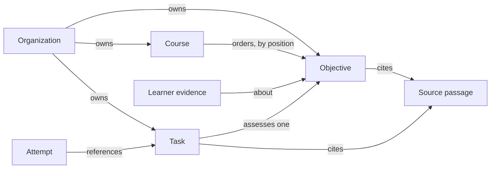

# Authoring

Status: living; checked against the code on 2026-10-31.

Content owners define what their learners study: objectives, courses that order them, and tasks that assess them. This is the authoring half of [product.md](../product.md)'s core job 1, "turn existing materials into structured learning content": material comes in as [sources](sources.md), a course may be drafted from it ([generation](generation.md)), and what the owner keeps is authored through the endpoints below, by the console accepting a draft, by an AI app through Braivo's MCP tools, or by any other caller of the HTTP API.

## How it works

An organization owns its objectives, courses, and tasks. A course orders objectives without owning them, so one objective may appear in several courses and keeps one knowledge estimate per learner. A task assesses exactly one objective and serves every course that objective is in. Objectives and tasks may cite passages of the organization's sources.

The authoring order is fixed by references: objectives first; courses, citations, and tasks then name their IDs, in any order. The README's "The API, end to end" walks it with `curl`.

| Endpoint                                                       | Body                                                                               | Success                                                                                                                                |
| -------------------------------------------------------------- | ---------------------------------------------------------------------------------- | -------------------------------------------------------------------------------------------------------------------------------------- |
| `POST /api/organizations/:id/objectives`                       | `{ "objectives": [{ "title", "key"? }] }`                                          | 201 `{ "objectiveIds": [...] }`, positionally matching                                                                                 |
| `GET /api/organizations/:id/objectives`                        | —                                                                                  | 200 `{ "objectives": [{ "id", "title", "courseIds", "pendingTaskCount" }] }`, by title                                                 |
| `GET /api/organizations/:id/objectives/:objectiveId/tasks`     | —                                                                                  | 200 `{ "tasks": [...] }`: unretired, oldest first, as authored with `id`, `citations`, `published`, and `findings`; 404                |
| `GET /api/organizations/:id/objectives/:objectiveId/citations` | —                                                                                  | 200 `{ "citations": [{ "sourceId", "start", "end", "quote" }] }`; 404                                                                  |
| `POST /api/organizations/:id/courses`                          | `{ "title", "objectiveIds": [...], "key"? }`                                       | 201 `{ "courseId", "added", "published" }`                                                                                             |
| `GET /api/organizations/:id/courses`                           | —                                                                                  | 200 `{ "courses": [{ "id", "number", "title", "urlLabel", "published", "hidden", "pendingTaskCount" }] }`, by title                    |
| `GET /api/organizations/:id/courses/:courseId`                 | —                                                                                  | 200 the course whole, with `published` and `hidden`: objectives in order, each with citations, tasks, and `otherPublishedCourses`; 404 |
| `POST /api/organizations/:id/courses/:courseId/delete`         | —                                                                                  | 204 an unpublished course deleted, its content kept; 409 published; 403 to a tool                                                      |
| `POST /api/organizations/:id/courses/:courseId/visibility`     | `{ "hidden": true }`                                                               | 204 a published course hidden from learners, or shown with `false`; 409 hiding an unpublished one; 403 to a tool                       |
| `POST /api/organizations/:id/publish`                          | `{ "courseIds"?: [...], "taskIds"?: [...] }`                                       | 204, all or none, from a browser session alone                                                                                         |
| `POST /api/organizations/:id/tasks`                            | `{ "tasks": [{ "objectiveId", "kind": "choice", …, "citations"?, "replaces"? }] }` | 201 `{ "tasks": [{ "id", "added", "published", "replaces"?, "findings"? }] }`, positionally matching                                   |
| `POST /api/organizations/:id/tasks/retire`                     | `{ "taskIds": [...] }`                                                             | 204, also when already retired; 403 to a tool naming one once published                                                                |

Citing an objective (`POST …/citations`) and how a quote is located are the [sources](sources.md) spec's.

Rules every authoring route shares (full statuses in `apps/server/api/index.ts`):

- **Who.** The actor is the session's user, from a browser cookie, a device-flow bearer token sent to the installation's host ([ADR 0022](../adr/0022-machine-access.md)), or a remote MCP connection ([ADR 0045](../adr/0045-remote-mcp.md)), and must hold `owner`, `admin`, or `author` in the organization: a content owner ([ADR 0048](../adr/0048-author-role.md)). Grading, people, and settings stay `owner` or `admin`; an `author` reaches no learner's data. Only a cookie publishes, hides or shows a course, deletes a course, or retires a task once published; a tool's correction of one, from a token or a connection, waits to be published (Publication). A `member` is a learner and gets 403, reads included, since tasks read back carry their answers. The `:id` in the path proves nothing on its own ([access.md](access.md)).
- **Writes** pass the origin check in [access](access.md), else 403; at most 1000 items (Publish 10,000 IDs), 200 quotes to locate, and 1 MB per request.
- **Order of checks.** A malformed body answers 400 before the role is checked, since the payload alone reveals nothing about the organization: its shape, a key that cannot be one, a task invalid for its kind. Then the role (403), then ownership of every referenced objective and replaced task (403, also for one that does not exist), then each citation in turn: its source's ownership (403, likewise) and its quote (400).
- **Refusals explain themselves** where the caller can fix them, since the caller is often a model ([ADR 0021](../adr/0021-citations.md)): a refused title, a malformed or conflicting key, a course listing an objective twice, an invalid task, a quote Braivo cannot find, a stale or duplicate correction, a second pending correction, or a tool's retirement of a task once published answers `{ "error" }` naming the item, as in "Task 1, citation 0: the quote does not occur in the source." A body not of the documented shape answers a bare 400.
- **All or nothing.** A batch with one invalid item stores nothing.
- **IDs** are opaque UUIDs Braivo generates, never a title, so two organizations can both have "Past tense".
- **Listings are by title, then ID**, so equal titles keep a stable order. Content order belongs only to a course.
- **Retries add nothing** ([ADR 0024](../adr/0024-idempotent-authoring.md)): a task by its content, an objective or course by the caller's key.

Objectives: titles are trimmed, non-blank, at most 500 characters, and storable text (no NUL, no unpaired surrogate). Duplicate titles are allowed. A `key`, optional, is the caller's name for the objective, unique in the organization: 1 to 128 lowercase letters, digits, and `. _ / -`, starting with a letter or digit. Sent again under its key with the same title, an objective answers its existing ID; under a key that names another title, the batch answers 409. A key repeated within one batch is one objective, on the same terms. Writers racing on one key share one objective. A key cannot be changed or released.

Courses: the title follows the objectives' rules. `objectiveIds` may be empty, lists each objective at most once, and its order is the content order selection works from ([learning-model.md](learning-model.md)). The course and its membership rows are written in one transaction. A `key` works as for objectives: the same title and objectives in the same order answer the existing ID, anything else under the key 409.

An unpublished course is deleted with `POST /api/organizations/:id/courses/:courseId/delete` ([ADR 0039](../adr/0039-published-in-the-console.md)): its place in courses and groups goes, its objectives, tasks, and citations stay, and it reads as no course from then on. Its key and number stay taken: a course sent again under the key answers 409, explained, rather than coming back unreviewed, and no other course draws the number ([ADR 0044](../adr/0044-course-numbers.md)). 204, also when deleted already; 409, explained, for a published course, which stays (nothing unpublishes; it can be hidden); 404 for a course the organization does not have; 403 to a request carrying a token, explained. A Publish naming a deleted course fails whole (409), and a group change adding one is refused; each of these and a keyed retry takes turns with a Delete, seeing the course whole or deleted.

A published course is hidden from learners with `POST /api/organizations/:id/courses/:courseId/visibility` `{ "hidden": true }`, and shown again with `false` ([ADR 0039](../adr/0039-published-in-the-console.md)): hidden, learners reach it as an unpublished one, not at all, while it stays published (so not deleted, its tasks keeping their state), its groups and learners' evidence kept for when it is shown. A learner's request admitted before a hide commits may still finish. 204, also when it already was; 409, explained, for hiding an unpublished course; 404 for a course the organization does not have; 403 to a request carrying a token, explained.

Publication ([ADR 0039](../adr/0039-published-in-the-console.md)): a course or task a tool creates, with its token or as a remote MCP connection, waits unpublished, reached by no learner, until a person publishes it in the console; one created with a browser session, as the console's review does, is published at once. A write answered by what is already there, a keyed course or a task's twin, never changes its state. Each write answers what it did and what learners reach, so a tool never reads a twin as just published: `added`, false for a keyed course or a twin found instead (a task repeated within one batch is added once); `published`, as it stands; and for a pending correction of a published task, `replaces`, naming the task still offered meanwhile. A pending task is offered and graded in no course, an attempt naming it answering 404 as for a missing task, and an objective whose tasks all wait has no task to practise. `POST /api/organizations/:id/publish` `{ courseIds?, taskIds? }`, at least one ID and at most 10,000 in all, publishes them all or none: 204, one already published keeping when it was, so a retry changes nothing; 409 when the organization has not every course, or a task was retired or corrected since, or is a correction whose task was; 403 for another organization's task, and to a request carrying a token. Publishing a course does not publish its tasks, nor a task its course: the console's Publish sends both, as its page showed them.

A course gets a number for learners' links, unique within the organization and never changed: drawn at random from 1000–9999 while any is free, then 10000–99999, then one past the largest, drawn again when a concurrent creation took it, and the first course's under a retried key ([ADR 0044](../adr/0044-course-numbers.md)). Its `urlLabel`, what follows the number in its links, is its title's (`urlLabel`) until `POST /api/organizations/:id/courses/:courseId/url-label` `{ urlLabel, previous }` sets another: 204 when the label was `previous` or is `urlLabel` already, so a retry succeeds; 409 with the label now when someone changed it meanwhile, leaving theirs; 400 for one `urlLabel` would write otherwise or empty; 404 for a course the organization does not have. Labels need not be unique. An objective without a task leaves a learner with no activity when it is the one selected, and caught up once it needs no attention, as in a course with no objectives ([learner-loop.md](learner-loop.md)).

Tasks: `content` validates the body by `kind`, `choice` or `typed` ([ADR 0038](../adr/0038-typed-answers.md)). A typed task has a `prompt`, 1 to 20 `accepted` answers, each 1 to 200 characters and distinct as answers are compared (case, spacing, and typographic quote marks aside), stored with spacing collapsed, the first shown to a learner who missed; an optional `explanation`; and an optional `answerLanguage`, a language tag stored canonical. A choice task has a `prompt`, 2 to 26 distinct `options`, `answer` the index of the correct one, an optional `explanation` shown after grading, and optional `keepOrder: true` to present options as written instead of shuffled. The prompt, each option, and the explanation are trimmed, 1 to 2000 characters, and storable. The prompt and options are stored with each run of spaces, tabs, and line breaks as one space, as a page collapses them (a no-break space inside one stays), so options that differ only in that spacing, or only in Unicode form (`ż` composed or as `z` and a combining dot, equal in NFC), are refused as repeated rather than reading the same and grading differently; the console's task editor checks the same. Each is stored in the Unicode form sent. A task may cite at most 10 passages, `{ "sourceId", "quote" }`, located as an objective's are and stored in the task's transaction; a learner sees them only after answering ([learner-loop.md](learner-loop.md)). New tasks in one batch are stamped a millisecond apart, so a learner meets them in the order given.

A task the objective already has, unretired, published or pending, with an equal body (key order aside; option order counts, since `answer` indexes it) and the same set of passages, is not stored again: its ID is answered, its state kept, also for a task repeated within one batch. A retired twin does not count, so adding a retired task again brings it back as a new one, read back as `matchesRetiredTask` while it waits. Adding and retiring lock the objectives they touch, so a twin is never answered as live after it was retired, and racing writers store one task.

Retiring withdraws a task from practice for good: it is never offered and accepts no new attempt, but stays stored, since attempts point at it, and the evidence it graded still counts. Retiring again keeps the first date; a batch with a task the organization does not own retires nothing (403), and so does a tool's batch with a task once published, retired since or not (403, explained: retiring one is the console's). Tasks are immutable: a task sent with `replaces`, naming one of the organization's tasks (else 403), is its correction, and, unless a tool corrects a published task (below), that task is retired in the same transaction, so learners meet one or the other. A correction is sent alone, for the task's own objective (else 400, explained): moving a task changes which courses ask it, so that is retiring and adding. Except for a tool's correction of a published task, a correction takes the task's state, published for a published task, pending for a pending one, so editing during review publishes nothing, and correcting a published task retires its pending correction too. A tool's correction of a published task instead waits beside it, read back with `replaces` naming it, the task still offered until Publish publishes the one and retires the other together; a task has one pending correction at a time, another answering 409, explained, naming it, and coded `CORRECTION_PENDING`, while correcting the pending one replaces it at once, for the same task. An unchanged correction answers the task's ID, retiring nothing, as a pending correction sent again answers its own; one equal to another task the objective has answers 409, explained and coded `DUPLICATE_CORRECTION`, as a duplicate, retiring nothing. Once the task is retired, a correction answers what it asks for if that is already there, as on a retry after a lost answer, changing nothing, and otherwise 409, explained: it was written from a stale read.

Reading back: an objective's tasks, answers and passages included, each saying whether it is `published`, in the shape they are authored in, so one read back can be sent again; a pending one identical to a retired task of its objective, however retired, is marked `matchesRetiredTask` (a retirement records no reason, so not that it was rejected); an objective's citations; and a course whole, its objectives in content order, each with its citations, its unretired tasks, and `otherPublishedCourses`, the organization's other published courses it is in, which its tasks reach too once published, plus each cited source once, without text. The courses listing and a course read say whether it is `hidden`. The objectives listing names the courses each is in (`courseIds`); both listings count what waits for review, unretired unpublished tasks (`pendingTaskCount`): an objective's own, a course's those of all its objectives, a task of an objective two courses share counted in both. Another organization's objective or course answers 404, as one that does not exist.

Findings: a task read back (an objective's tasks, a course read), and each task a write answers, carries `findings` when it has something a learner may run into as written, absent when none. They are advisory: computed on each read from the task's body, never stored, blocking nothing, changing no grading ([ADR 0038](../adr/0038-typed-answers.md)), and gone once what raised one no longer holds of the task. The checks are deterministic and depend on no language. Each is a code with the text it concerns, for the reader to word:

- `typed-trailing-punctuation`: an accepted answer ending in a sentence mark of the scripts most courses are written in (`.`, `!`, `?`, `...`, `…`, `。`, `！`, `？`, `؟`, `।`, and the like; not the Greek `;`, a semicolon once NFC), inside one pair of quotes around it as its language pairs them (`„Dzień dobry.”`, `„Hallo.“`, `「はい。」`), that no accepted answer equals without it, as answers are compared, with what is left holding a letter or digit (`Mr.` and `42.` are flagged, `3.5`, `Dr. Who`, and `?` not). Its `suggestion` is the answer without the mark, quotes kept, left out when it would open with `¿` or `¡` or the task already has as many answers as one accepts.
- `typed-literal-delimiters`: an accepted answer holding a spaced or fullwidth slash or a parenthesised part, ASCII or fullwidth, which is matched as written (`colour / color`, `(to) go`, and `色／颜色` are flagged, `km/h` not).
- `choice-correct-alike`: the correct option equal to a distractor once case, quote marks (apostrophes included), and a final mark are set aside, naming in `differences` each of `case`, `punctuation`, and `quotes` that makes them equal (`Paris` and `paris.`: case and punctuation; `can't` and `cant`: quotes). Distractors alike among themselves are not flagged.

What an author cannot do: edit or reorder a course, but for its URL label, or delete a published one; edit or delete an objective or a citation, for which the path does not exist. Tasks are immutable by design, corrected and retired as above. The database refuses to delete an objective anything refers to, and Better Auth's organization delete answers 409 while the organization owns objectives, courses, sources, or files.

Console: an organization's page lists its courses, marking one hidden from learners Hidden, one pending review Needs review, and a published one with pending tasks of objectives in it alone with their count (3 tasks need review), with a button to its sources, Add material leading to their add form, or Open Sources while it has none, and links its sources, where a course is drafted from a source and authored once reviewed ([generation](generation.md)). Each pending task is counted there once ([ADR 0039](../adr/0039-published-in-the-console.md)): under its course when its objective is in that course alone, else under Other objectives, which links its objective with its count and how many courses it is in (In no course, In 2 courses); an objective in no course is listed there with nothing pending too, since no course's page leads to its published tasks. A course's page, while it waits, says to review it below, its pending tasks first, which learners cannot see until published; while it is published and tasks wait, how many wait for review, which learners are not asked until published. Nothing is selected when it opens; Publish selected (2) sends the pending tasks selected, and Publish all (3) every pending task the page shows; while the course waits, both send it too (Publish without tasks needing review, Publish with selected (2), Publish with all (3)), and with no task pending, Publish sends it alone. Each sends one request, so whatever is not selected, or was written since, waits; it is asked first, naming them, when the tasks sent have objectives in other published courses, and neither button sends while one does, the one sending saying Publishing…; the buttons stay in view while the page scrolls. Then it reloads the page, focuses its title, and says it was published; refused because something it sent was retired or corrected meanwhile, it does the same, saying nothing was published and to review the page; it says a failure, and reloads when the reader's access changed meanwhile. Published, it names its learner link, `https://<learn domain>/c/4732-everyday-english` (a `.localhost` one on a dev server over HTTP at the learn app's port: [ADR 0043](../adr/0043-development-demo.md)), with Copy address, once the organization has a learn domain, and edits the label in its link, showing the path as it will be written, that the number alone reaches it too, and that links sent before keep working; Save label says Saved., or, changed meanwhile by someone else, says to what and keeps what was typed, replacing theirs only if saved again; each save is over the label it last saved or was told of, never one a reload brought unseen; a label with no letter or digit is refused before sending. A session ended meanwhile goes to sign in, and back; a save refused as sent (400, 403, 404) says to reload and try again, and the course is read again, not found if it is gone or no longer theirs. It then links its learners' progress ([progress.md](progress.md)); while the course is published, Hide from learners, asked first, saying that what they learned stays; hidden, the page marks it Hidden in place of its learner link, with Show to learners, not asked. Each waits for an open editor and for Publish, as Delete does, then reloads the page, focuses its title, and says what it did; a failure is said, to try again; while the course waits, Delete course. It asks first, saying that learners never saw it, its objectives and tasks stay, and it can't be undone; it waits for an open editor, as Publish does, and neither Publish nor an editor starts while it deletes. Deleted, the organization's courses open; published by someone meanwhile, the page reloads saying it was not deleted; a failure is said, to try again. Then, under Needs review, each objective with pending tasks, in course order, with a checkbox selecting all of them, and its pending tasks, each marked Unpublished with its own checkbox, a pending correction with the task it corrects as published now beneath it, without buttons; then, under What it teaches, the course whole: each objective's passages, then its published tasks, or that its tasks wait above. Each task, with its answer, explanation, and passages, has a Retire button that asks first and an Edit button that corrects the task (a duplicate of another task said so, the edit kept), keeping its passages, a choice task's option order, and a typed task's answer language; for a pending task both say that learners have not been asked it and that the correction waits too, and for a task a correction waits to replace, that it is retired with it. A pending correction says which task it corrects, which stays published until then, and a pending task read back `matchesRetiredTask` says that an identical task was retired before. A pending task's buttons are named for it as an unpublished task (Edit unpublished task “…”), since a correction usually keeps its task's prompt. One task's editor is open at a time on the page, the other Edit buttons disabled meanwhile, since correcting a task retires its pending correction, shown in the other section. Publish waits for an open editor to be saved or cancelled, saying so, and no editor opens while it publishes, since its reload would close the editor and lose the edit. A task retired or corrected takes the focus to its objective's heading, or to the course's title once the objective has no task left pending. An objective's page names the courses it is in, linked, an unpublished one said so, or that it is in none, its published tasks asked of learners only once a published course includes it; while tasks wait, Publish selected and Publish all send its pending tasks alone, asked first, naming them, when they reach published courses; then its pending tasks, selectable, and its published tasks, each with Edit and Retire, as on a course's page, which shows them too. Objectives and courses are not written by hand there, and tasks only as corrections.

AI apps: `/mcp` (access-40) serves the endpoints above as tools (`define_objectives`, `cite_sources`, `author_tasks`, `list_tasks`, `retire_tasks`, `create_course`, `read_course`, and the listings) acting as the connection's person in its organization, with no rule of its own beyond the API's ([ADR 0045](../adr/0045-remote-mcp.md)). Its instructions and tool descriptions ask the agent for a key on every objective and course and to resend it on a retry, say that its tasks, courses, and corrections of published tasks wait for their owner to publish them in the console, which no tool can, that a published task is retired there, and that a course is rearranged as a new one under a new key, the person deleting the old one there, and it hands Braivo's explanation of a refusal back to the agent. `author_tasks` and `list_tasks` say what each finding's code means and ask the agent to review each, correcting a task with the answer a learner would likely give when it should count, leaving one right as written, and, when a correction of the published task already waits, correcting that one instead unless it already resolves the finding. `author_tasks` and `create_course` answer as their routes do, plus `reviewUrl`, the console's page where the owner publishes: the course's, or for tasks the organization's (`/<organization>`), which lists the courses and objectives with tasks pending, each task once. A task reaches learners only through a published course its objective is in, so the instructions ask for its objective in a course. The URL is read after the write and left out when that lookup fails or stalls, never holding back the write's answer. The browser client (`@braivo/server/client`) has a method for every route here but an objective's citations, plus `acceptDraft`, which authors a reviewed draft in steps safe to repeat.

## Invariants

- Only an `owner`, `admin`, or `author` of the organization may create, list, or read back its objectives, courses, and tasks, every author all of them, whoever wrote them. `apps/server/application/objectives.test.ts`, `apps/server/application/courses.test.ts`, `apps/server/application/tasks.test.ts`, `apps/server/api/authoring.test.ts`
- A malformed course or task is refused before the actor's role is read. `apps/server/application/courses.test.ts`, `apps/server/application/tasks.test.ts`
- A course arranges only its own organization's objectives, enforced by the use case and by composite foreign keys. `apps/server/application/courses.test.ts`, `apps/server/persistence/course.test.ts`
- A task assesses only its own organization's objective, enforced by the use case and by a composite foreign key, and cites only its organization's sources. `apps/server/application/tasks.test.ts`, `apps/server/persistence/task.test.ts`
- A course keeps its objectives in the order given, each at most once, no two at one position. `apps/server/persistence/course.test.ts`
- A course is created whole or not at all. `apps/server/persistence/course.test.ts`
- A course a token or a connection creates reaches no learner, listed or by its routes, until a browser session publishes it; neither can publish, and publishing is all or none. `apps/server/api/authoring.test.ts`, `apps/server/api/mcp.test.ts`, `apps/server/persistence/course.test.ts`
- A task a tool newly creates is offered and graded in no course, those sharing its objective included, until a browser session publishes it; a correction takes the state of the task it replaces, but a tool's correction of a published task waits, one at a time, the task offered until Publish retires it as it publishes the correction, and the console's correcting or retiring the task retires the correction too; a tool never retires a task once published, however it races with Publish, and a correction racing Publish never deadlocks; a task re-imported after the console corrected or retired it comes back pending; Publish is all or none over courses and tasks, refused for one retired or corrected since (409) or another organization's (403), and a retry changes nothing. `apps/server/api/authoring.test.ts`, `apps/server/application/tasks.test.ts`, `apps/server/persistence/course.test.ts`, `apps/server/api/client.contract.test.ts`
- The console's Publish sends the pending tasks selected (none on opening; an objective's checkbox selects its own) or every one its page shows, with the course if it waits, asking first when they reach other published courses, naming them; whatever it did not send still waits. One task's editor is open at a time, and it, Publish, an unpublished course's Delete, and a published one's Hide or Show each wait while another is under way. The organization's page counts each pending task once, under its course when its objective is in no other, else under its objective, whose page publishes its pending tasks alone, naming the published courses they reach. `apps/console/test/courses-publish.test.tsx`, `apps/console/test/courses.test.tsx`, `apps/console/test/objectives-review.test.tsx`, `apps/server/persistence/objective.test.ts`, `apps/server/application/courses.test.ts`
- A course's number is unique within its organization and never changes: drawn at random, four digits while any is free, drawn again when a concurrent creation took it, kept by a keyed retry; several adding one course under its key at once get one course. Its URL label is set only over the label read, repeating a change succeeds, and only the organization's `owner`, `admin`, or `author` sets it. `apps/server/persistence/course.test.ts`, `apps/server/api/authoring.test.ts`, `apps/server/api/client.contract.test.ts`, `apps/console/test/courses.test.tsx`
- One invalid task, or one quote not found in its source, refuses the whole batch, naming it. `apps/server/application/tasks.test.ts`, `apps/server/api/authoring.test.ts`
- A stored task body is a valid one of its kind; a blank, NUL-carrying, or malformed text is refused, and so are options equal but for their spaces, tabs, and line breaks. `apps/server/content/task.test.ts`, `packages/ui/compositions/task-editor.test.tsx`
- A title past 500 characters once trimmed, blank, or not storable is refused, naming the objective or course, before the actor's role is read. `apps/server/application/objectives.test.ts`, `apps/server/application/courses.test.ts`, `apps/server/api/authoring.test.ts`
- Task citations follow the sources spec's citation rules (sources-15, sources-16), including at most 10 per task and 200 quotes per request. `apps/server/api/authoring.test.ts`
- Tasks from one batch are offered in the order given. `apps/server/application/tasks.test.ts`
- Generated IDs match the request's order, and two organizations get distinct objectives for the same title. `apps/server/persistence/objective.test.ts`, `apps/server/application/objectives.test.ts`
- An objective or course sent again under its key answers the same ID; under a key naming something else the request is refused, explained, and stores nothing; keys are per organization, and writers racing on one, in any order, share it without deadlock. `apps/server/persistence/objective.test.ts`, `apps/server/api/authoring.test.ts` (course keys only through the API)
- Adding a task the objective already has, unretired, answers its ID, its state kept, also within one batch and for racing writers; other passages or another option order make another task, and a retired twin is added anew. `apps/server/application/tasks.test.ts`, `apps/server/persistence/task.test.ts` (retiring takes the adders' lock)
- Reading back answers an objective's unretired tasks as authored, published or pending, and a course whole in content order; another organization's answers 404. A pending task is marked `matchesRetiredTask` exactly when a retired task of its objective is its twin, however it was retired; a published one never. `apps/server/api/authoring.test.ts`, `apps/server/application/tasks.test.ts`, `apps/console/test/objectives-review.test.tsx`
- An objective a course uses cannot be deleted; deleting a course removes only its arrangement. `apps/server/persistence/course.test.ts`
- Only a published course is hidden (showing an unpublished one changes nothing), only from a browser; hidden, it reaches no learner, listed or by its routes, and stays published, undeletable, its evidence kept. `apps/server/persistence/course.test.ts`, `apps/server/api/authoring.test.ts`, `apps/server/api/client.contract.test.ts`, `apps/console/test/courses-publish.test.tsx`, `apps/console/test/courses.test.tsx`
- Only an unpublished course is deleted, only from a browser, removing its arrangement in courses and groups and keeping its content, key, and number; a keyed retry, Publish, and a group change racing it see it whole or deleted, never an empty course. `apps/server/persistence/course.test.ts`, `apps/server/api/authoring.test.ts`, `apps/server/api/client.contract.test.ts`, `apps/console/test/courses-publish.test.tsx`
- An objective a task uses cannot be deleted. `apps/server/persistence/task.test.ts`
- An organization that owns objectives, courses, sources, or files cannot be deleted. `apps/server/auth/auth.test.ts`, `apps/server/persistence/organization.test.ts`, `apps/server/persistence/objective.test.ts`, `apps/server/persistence/course.test.ts`
- A task's authored content and passages never change once stored: there is no update path, and retiring records only when. `apps/server/persistence/task.test.ts`
- A retired task is never offered, accepts no new attempt, and retiring twice keeps the first date; only an `owner`, `admin`, or `author` retires, and only the organization's own tasks. `apps/server/application/tasks.test.ts`, `apps/server/persistence/task.test.ts`
- The console retires a task only once the owner confirms. `apps/console/test/courses.test.tsx`
- A correction, sent alone for its own objective and the organization's own task, stores and retires in one transaction, or for a tool's of a published task stores and waits: resent, it answers the same while its correction is unretired; unchanged, it keeps the task; stale, it stores nothing unless what it asks for is there; equal to another task, it is refused; and of two different corrections racing on one task, one is refused. `apps/server/api/authoring.test.ts`, `apps/server/application/tasks.test.ts`, `apps/server/api/client.contract.test.ts`
- The console corrects a task with its passages and option order, its editor disabled while sending and until the course is read again, so the old task is never offered to edit; a reload unanswered within 10 seconds fails the page, offering Try again rather than calling the correction failed. `apps/console/test/courses.test.tsx`
- The MCP tools offer authoring and return Braivo's refusal reason to the agent. `apps/server/mcp/server.test.ts`
- A task written or read back carries its findings exactly when it has any, as the checks define them, through the routes and the tools alike; they change neither what is stored nor how it is graded. `apps/server/content/findings.test.ts`, `apps/server/api/authoring.test.ts`, `apps/server/mcp/server.test.ts`
- A write answers whether it added each course or task or found it, and whether it is published, a twin's or a keyed course's as it stands; a pending correction names the task it will replace. `apps/server/mcp/server.test.ts`, `apps/server/api/mcp.test.ts`, `apps/server/api/authoring.test.ts`
- `/mcp` (access-40) offers no group or progress tool until the `braivo:progress` scope; a connection's courses, tasks, and corrections of published tasks wait as a token's do, and it never publishes or retires a published task. `apps/server/mcp/server.test.ts`, `apps/server/api/mcp.test.ts`

## Decisions

- [ADR 0008](../adr/0008-courses-order-objectives.md): courses order objectives rather than own them, and position is erased at the storage boundary.
- [ADR 0015](../adr/0015-tasks.md): tasks are immutable, one objective each, with a JSON body per kind; `choice` first.
- [ADR 0038](../adr/0038-typed-answers.md): the `typed` kind, how its answers are compared, and Show answer.
- [ADR 0021](../adr/0021-citations.md): a task cites passages when created, at most 10; refusals explain themselves.
- [ADR 0024](../adr/0024-idempotent-authoring.md): a task added again returns its twin; objectives and courses by the caller's key.
- [ADR 0022](../adr/0022-machine-access.md): `braivo` signs in through the device flow and acts as the content owner.
- [ADR 0045](../adr/0045-remote-mcp.md): `/mcp` serves the API as tools and decides nothing of its own.
- [ADR 0029](../adr/0029-server-drafting.md): Braivo's own draft is reviewed in the console before anything is stored.
- [ADR 0048](../adr/0048-author-role.md): `owner`, `admin`, and `author` author and publish, every author all of the organization's content.
- [ADR 0039](../adr/0039-published-in-the-console.md): what a tool writes waits to be published in the console, reviewed on a course's or an objective's page.
- [ADR 0006](../adr/0006-better-auth.md): organizations and roles come from Better Auth, and an organization ID in a request is not authorization.
- [ADR 0010](../adr/0010-hono-http-layer.md): a route resolves the session and calls one use case.
- [ADR 0005](../adr/0005-postgresql-drizzle.md): tables follow implemented requirements, which is why there is no module or lesson level.
- [ADR 0004](../adr/0004-one-application-origin.md): the console addresses an organization by slug at the installation's origin.

## Gaps

| Gap                                                                                             | Impact                                                                                                                    | Next step                                                                             |
| ----------------------------------------------------------------------------------------------- | ------------------------------------------------------------------------------------------------------------------------- | ------------------------------------------------------------------------------------- |
| Content records neither who wrote, published, or retired it, nor through which client           | With several authors in a school, neither an administrator nor a reviewer can tell which colleague or client changed what | Decide what to record before schools share authoring among several authors (ADR 0048) |
| The console authors only by accepting a draft or correcting a task: no new hand-written content | Without the installation's AI or their own AI app, a content owner cannot author at all                                   | Console forms for objectives, tasks, and courses                                      |
| No edit of objective or course titles or keys                                                   | A typo is permanent                                                                                                       | Add a rename endpoint                                                                 |
| Courses cannot be reordered or extended after creation                                          | Any curriculum change means a new course ID that learners and links must move to                                          | Endpoint to replace a course's objective list                                         |
| Evidence graded by a task later retired still counts                                            | A wrong answer key may have marked right answers wrong, and estimates keep it                                             | Decide: discount, regrade, or leave it                                                |
| Nothing but an unpublished course can be deleted, not unused objectives or a wrong citation     | Mistakes accumulate; organization deletion is blocked forever once content exists                                         | Decide deletion for unused objectives, tasks, citations                               |
| Batch order relies on `createdAt` offsets                                                       | Two batches sent close together can interleave                                                                            | Ordering column when authoring needs one (noted in `createTasks`)                     |
| `choice` and `typed` only; one objective per task                                               | Open answers and multi-step problems cannot be assessed                                                                   | Next kind per ADR 0015, with stored AI grades                                         |

## Entry points

| Concern                    | Where                                                                                                                                                                                                               |
| -------------------------- | ------------------------------------------------------------------------------------------------------------------------------------------------------------------------------------------------------------------- |
| Routes and body parsing    | `apps/server/api/authoring.ts` (`parseObjectives`, `parseCourse`, `parseTasks`, `parseTaskIds`, `parsePublication`), `apps/server/api/refusals.ts`                                                                  |
| Public contract            | `apps/server/api/index.ts`                                                                                                                                                                                          |
| Use cases                  | `apps/server/application/objectives.ts`, `apps/server/application/courses.ts` (`readAuthoredCourse`), `apps/server/application/tasks.ts`                                                                            |
| Locating a task's passages | `apps/server/application/citations.ts` (`locateCitations`)                                                                                                                                                          |
| Permission check           | `apps/server/application/permission.ts` (`assertMayAuthor`)                                                                                                                                                         |
| Task kinds and validation  | `apps/server/content/task.ts` (`parseTaskBody`)                                                                                                                                                                     |
| Findings                   | `apps/server/content/findings.ts` (`taskFindings`)                                                                                                                                     |
| Keys and title limits      | `apps/server/content/key.ts`, `apps/server/content/text.ts`                                                                                                                                                         |
| Queries, twins, and locks  | `apps/server/persistence/objective.ts`, `apps/server/persistence/course.ts`, `apps/server/persistence/task.ts` (`createTasks`, `replaceTask`, `markTasksRetired`)                                                   |
| Publication                | `apps/server/persistence/publication.ts` (`markPublished`), `apps/server/application/courses.ts` (`publish`)                                                                                                        |
| Tables                     | `packages/db/schema/learning.ts` (`objective`, `course`, `courseObjective`, `task`, `taskCitation`)                                                                                                                 |
| Organization delete guard  | `apps/server/auth/auth.ts` (`beforeDeleteOrganization`), `apps/server/persistence/organization.ts`                                                                                                                  |
| Browser client             | `apps/server/api/client.ts`                                                                                                                                                                                         |
| MCP tools                  | `apps/server/mcp/server.ts`                                                                                                                                                                                         |
| Console screens            | `apps/console/routes/_signed-in/$organizationSlug/` (`index.tsx`, `courses/$courseId/index.tsx`, `objectives/$objectiveId.tsx`, `sources/`); `apps/console/components/task-review.tsx`, the review both pages share |
